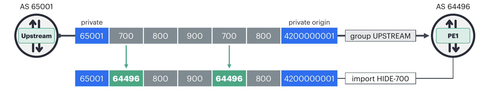
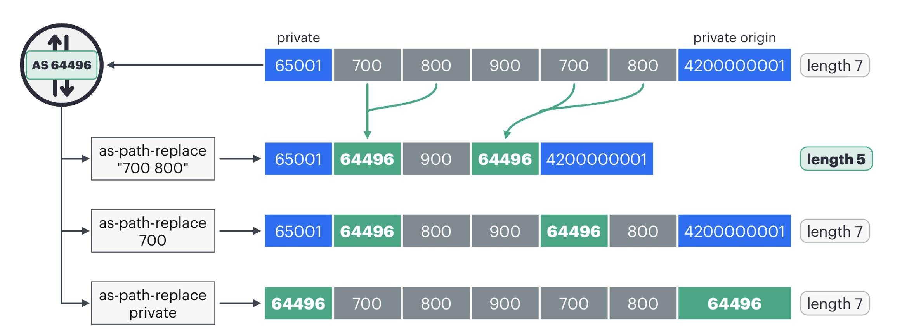
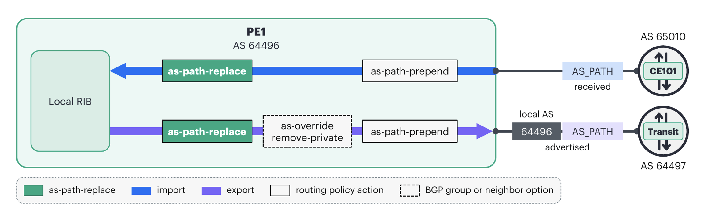
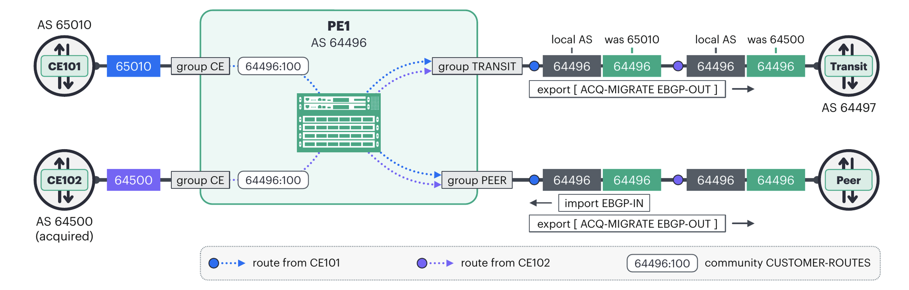

# AS Path Manipulation in Junos OS - Introducing as-path-replace

**Moshiko Nayman - 2026-11-02**

## Introduction

Junos OS 25.4R1 adds as-path-replace, a routing policy action for rewriting the BGP AS_PATH. The action takes the AS numbers to look for, or the keyword private to cover every private AS number, and replaces each match with the session's local AS. Operators can use it to keep private AS numbers out of the default-free zone, retire an AS number after an acquisition, or even out path lengths for load sharing.
Junos already has several ways to change the AS_PATH, each built for a narrower case. Prepending is a policy action on import and export, but it can only add to the path. as-override and remove-private also change numbers already in the path, but they have narrower scopes: they apply to every route advertised to a peer, replacing the peer's AS with the local AS (as-override) or removing private AS numbers (remove-private). as-path-replace is the first action that lets you select specific AS numbers to rewrite, replacing each match with the session's local AS, for the routes a policy term selects, on import as well as export. That flexibility matters because routers use the AS_PATH to detect loops and compare paths, so rewriting it changes how other networks treat the route.

## A Simple Example

We want routes that pass through AS 700 to carry our AS, 64496, in its place. A from condition picks the routes, and as-path-replace makes the change:

```
set policy-options as-path VIA-700 ".* 700 .*"
set policy-options policy-statement HIDE-700 term T1 from as-path VIA-700
set policy-options policy-statement HIDE-700 term T1 then as-path-replace 700
set policy-options policy-statement HIDE-700 term T1 then accept
set protocols bgp group UPSTREAM import HIDE-700
```

In our lab, a route arrived from AS 65001 with the AS_PATH 65001 700 800 900 700 800 4200000001 and was stored as 65001 64496 800 900 64496 800 4200000001. Both 700s became 64496, and the path length stayed the same, as Figure 1 shows:



The from clause can use any AS_PATH match condition. as-path-transits, for example, matches routes that carry any member of a named AS list anywhere in the path. Juniper documents it as faster to evaluate than a regular expression, and in our lab it picked the same route:

```
set policy-options as-list AS-700 members 700
set policy-options policy-statement HIDE-700 term T1 from as-path-transits as-list AS-700
```

as-path-neighbors and as-path-origins work the same way on the first and the last AS in the path.

## The Existing Toolkit
### as-override

Configured on a BGP neighbor or group, as-override replaces every occurrence of the peer AS with the local AS on advertisement. It is the standard answer for Layer 3 VPN PE-to-CE sessions where a customer reuses one AS at several sites. On the receiving router, its counterpart is the loops statement, which raises how many times the local AS may appear in a received path before loop detection hides the route.

```
set routing-instances VPN-A protocols bgp group CE neighbor 192.168.11.1 as-override
```

### remove-private

remove-private strips private AS numbers before advertising. By default it works from the left of the path and stops at the first public AS. With the all option it removes every private AS in the path, and with all replace it substitutes the local AS of the group for each one, so the path length stays the same.

```
set protocols bgp group TRANSIT remove-private all replace
```

### local-as, independent-domain, and strip-as-path

local-as makes one session present a different AS and is the normal AS migration tool. By default the session advertises both numbers, the local AS in front of the global AS. no-prepend-global-as leaves only the local AS. Junos adds these numbers as it builds the update, after export policy, so as-path-replace cannot remove them; in our lab the AS a session adds always went on after policy. In a migration the two features work together: local-as sets the AS the session presents, and as-path-replace rewrites what is already in the path. independent-domain carries a customer's BGP attributes, AS_PATH included, across the provider core and hands them back unchanged at the far PE. strip-as-path replaces the entire received AS_PATH with the local AS on import. It works, but the information it discards cannot be recovered.

```plaintext
set protocols bgp group MIGRATION local-as 64501 no-prepend-global-as
set policy-options policy-statement DO-STRIP term A then strip-as-path
```

### Which Knob to Use?

Table: When using a knob?

| Situation | Use |
|---|---|
| A customer reuses one AS at several sites behind PE-to-CE eBGP | `as-override` on the CE group |
| Private AS numbers must not leak, for every route on the session | `remove-private`, or `remove-private all` replace to keep the length |
| Private AS numbers must not leak, but only on selected routes | `as-path-replace private` behind a `from` clause |
| One specific public AS number must disappear from external advertisements | `as-path-replace <as>` |
| Inside a domain you control, a known run of AS numbers must collapse to one hop so path lengths line up | `as-path-replace "<as-numbers>"` |
| A path must look longer so that it is less preferred | `as-path-prepend` |
| One session must speak a different AS during a migration | `local-as`, plus `no-prepend-global-as` to hide the global AS |
| A customer's AS_PATH must reach the far PE exactly as the CE sent it | `independent-domain` |
| The received path is worthless and should be discarded entirely | `strip-as-path` |

## The as-path-replace Statement
### Syntax

as-path-replace goes in the then clause, for a whole policy or for one of its terms:

```plaintext
set policy-options policy-statement <name> then as-path-replace (<as-numbers> | private)
set policy-options policy-statement <name> term <term> then as-path-replace (<as-numbers> | private)
```

> Note: Quote the argument the way you would for as-path-prepend. A list needs quotes, and a lone AS number does not. In our 26.2R1 lab, an unquoted list such as as-path-replace 65001 65002 leaves no as-path-replace line in the candidate configuration, so nothing is replaced. If automation generates your policy, confirm the line landed with show policy-options in configuration mode, or show policy <name> after the commit.

### How Matching Works

Every match, whether a single AS number or a contiguous run of them, becomes one copy of the local AS. What that does to the AS_PATH length depends on the argument, as Figure 2 shows:

- Bullet itemA single AS number is replaced at every occurrence, one for one. The path length does not change.
- Bullet itemWith the keyword private, any number in either RFC 6996 private range, 64512 through 65534 or 4200000000 through 4294967294, is a match, and each one gets its own copy of the local AS. Four-byte AS numbers need no special handling: in our lab the two-byte 65001 and the four-byte 4200000001 both became 64496, so the length did not change.
- Bullet itemA quoted list is matched as a contiguous sequence, in the order given, and each occurrence of the run collapses into one local AS, so the path gets shorter. If the exact sequence does not appear, nothing changes.



We applied each statement below in our lab, one at a time, to the same received route. It arrives with the seven-hop AS_PATH 65001 700 800 900 700 800 4200000001, and our local AS is 64496:

Table: Configuration results

| Configuration statement | Resulting AS_PATH | Effect |
|---|---|---|
| `as-path-replace private` | `64496 700 800 900 700 800 64496` | Each private AS becomes 64496, length unchanged |
| `as-path-replace 700` | `65001 64496 800 900 64496 800 4200000001` | Each occurrence replaced, length unchanged |
| `as-path-replace "700 800"` | `65001 64496 900 64496 4200000001` | Both runs collapse, length 7 becomes 5 |
| `as-path-replace "800 900"` | `65001 700 64496 700 800 4200000001` | One run collapses, length 7 becomes 6 |
| `as-path-replace "800 700"` | `65001 700 800 900 700 800 4200000001` | That order never occurs, nothing replaced |

> Note: as-path-replace works only on numbers the route already carries. The AS the router puts in front of the path when it advertises to an eBGP peer is added after export policy has run, so the policy never sees it.

## Where It Runs in the Policy Pipeline

When several AS_PATH actions apply, each works on what the previous one left, so the order matters. We measured it in our lab on 26.2R1, and import and export do not behave the same way, as Figure 3 shows:



- Bullet itemOn import, a prepend in the same term ran before as-path-replace: a 300 prepended by the import policy was itself rewritten by as-path-replace 300.
- Bullet itemOn export, as-path-replace ran first. With as-override on the session, a quoted list ending in the peer's own AS still matched and collapsed, so as-override had not touched the path yet.
- Bullet itemremove-private on the same session also acted after as-path-replace: a quoted list that included a private AS still matched it, so the rewrite happened before remove-private stripped anything.
- Bullet itemPrepending on export came after as-path-replace, as-override and remove-private. A 300 prepended by the export policy survived as-path-replace 300 in the same term, and a prepended private AS survived remove-private. A prepended copy of the peer's own AS was not rewritten by as-override either, so the peer hid the route as a loop.

## Worked Examples

Our AS is 64496 throughout, and Figure 4 shows where each policy attaches and what each neighbor sees on the wire.



### Scrubbing Private AS Numbers Toward Transit

For customer routes sent toward the default-free zone, we replace private AS numbers with our own AS, so nothing private leaks and the path length stays the same. remove-private all replace on the group would do the same, but for every route on the session. Our policy limits the rewrite to routes tagged with the CUSTOMER-ROUTES community, the ones that carry CPE AS numbers. The CE group's import policy adds that community, as Figure 4 shows; we do not list that policy here.

```
set policy-options community CUSTOMER-ROUTES members 64496:100

set policy-options policy-statement EBGP-OUT term SCRUB-PRIVATE from community CUSTOMER-ROUTES
set policy-options policy-statement EBGP-OUT term SCRUB-PRIVATE then as-path-replace private
set policy-options policy-statement EBGP-OUT term SCRUB-PRIVATE then next term
set policy-options policy-statement EBGP-OUT term ANNOUNCE from community CUSTOMER-ROUTES
set policy-options policy-statement EBGP-OUT term ANNOUNCE then accept
set policy-options policy-statement EBGP-OUT term REST then reject

set protocols bgp group TRANSIT export EBGP-OUT
```

as-path-replace modifies the route but does not accept or reject it. The explicit next term keeps the rewrite apart from the accept or reject decision, which makes the policy easier to read.

### Retiring an AS Number After an Acquisition

We have acquired AS 64500 and want it removed from everything we advertise externally, without renumbering the acquired devices on day one. A new policy, ACQ-MIGRATE, makes the rewrite and is chained in front of EBGP-OUT on the TRANSIT and PEER groups. It has no accept or reject of its own, because a terminating action would end the chain: an accept would bypass EBGP-OUT and leak routes, and a reject would drop them. Order matters. TRANSIT already has EBGP-OUT from the previous example, and in our lab a set on such a group appended ACQ-MIGRATE after EBGP-OUT, even when the set listed [ ACQ-MIGRATE EBGP-OUT ] in that order. EBGP-OUT would then accept the routes before ACQ-MIGRATE ever ran, so the insert line moves ACQ-MIGRATE in front of it. PEER has no export policy yet, so there the bracketed list sets the order directly.

```
set policy-options as-path CONTAINS-64500 ".* 64500 .*"

set policy-options policy-statement ACQ-MIGRATE term OLD-AS from as-path CONTAINS-64500
set policy-options policy-statement ACQ-MIGRATE term OLD-AS then as-path-replace 64500
set policy-options policy-statement ACQ-MIGRATE term OLD-AS then next policy

set protocols bgp group TRANSIT export ACQ-MIGRATE
insert protocols bgp group TRANSIT export ACQ-MIGRATE before EBGP-OUT
set protocols bgp group PEER export [ ACQ-MIGRATE EBGP-OUT ]
```

This chain is also how you make two different rewrites on one session: each gets its own policy statement, and only the last one accepts or rejects. In our lab, with the community match left out of EBGP-OUT, a route received as 65001 64500 left through [ ACQ-MIGRATE EBGP-OUT ] as 64496 64496 64496: both rewrites applied, plus the AS the router adds on advertisement (see Note above).

### Collapsing a Known Sequence on Import

The action also works on import, so a router can normalize the paths it receives from a neighboring domain under the same administration. In this example the PEER group connects to that domain, not to an Internet peer. BGP load-shares only across paths whose AS_PATHs are the same length. Some of that domain's paths carry the two-hop sequence 65020 65021 in place of a single AS, which makes them one hop longer than the rest. Collapsing the sequence to one hop carrying our AS evens out the lengths for load balancing.

```
set policy-options policy-statement EBGP-IN term NORMALIZE then as-path-replace "65020 65021"
set policy-options policy-statement EBGP-IN term NORMALIZE then next term
set policy-options policy-statement EBGP-IN term REST then accept

set protocols bgp group PEER import EBGP-IN
```

> Note: This example shortens the AS_PATH, which changes best path selection, so use it only where you control the design on both ends. It also writes our own AS into the stored path. In our lab the rewriting router kept the route active and flagged the path Looped: 64496, while an iBGP peer in AS 64496 hid the same route with the reason AS path loop. Raising loops on that peer fixed it, but only once loops was higher than the number of times 64496 appeared. A rewrite that collapsed two runs wrote 64496 twice, so loops 2 was not enough and loops 3 was. Keep the import form for eBGP-only designs, or set loops on every iBGP receiver and route reflector first.

## Observability

Test policy runs a policy against inet.0 before you attach it to any session. It is the quickest way to confirm the terms catch the routes you intended, but it reports only which routes are accepted and rejected, not the attributes a term changes. To see the rewritten path, attach the policy and read the route back: show route for an import rewrite, show route advertising-protocol bgp for an export rewrite. show route receive-protocol bgp shows the path exactly as the peer sent it, before import policy, so it is the before view for an import rewrite.

```
test policy EBGP-OUT 10.0.0.0/24
show route <prefix> detail
show route receive-protocol bgp <neighbor> <prefix> detail
show route advertising-protocol bgp <neighbor> <prefix> detail
show policy EBGP-OUT
```

In our lab, a neighbor in AS 65001 sends us 192.0.2.0/24, originated in AS 4200000001, and we rewrite on import. The lab runs each router in this example as a virtual-router instance on one vEVO, which is why the commands below include a table qualifier; on separate routers, leave it off. The path as received, before policy:

```
mnayman@P1-vEVO> show route receive-protocol bgp 10.99.0.1 192.0.2.0/24 detail table ASPR-LOCAL.inet.0

* 192.0.2.0/24 (1 entry, 1 announced)
     Accepted
     Nexthop: 10.99.0.1
     AS path: 65001 700 800 900 700 800 4200000001 I
```

After as-path-replace "700 800" on the import policy, each run of 700 800 becomes a single 64496, the path drops from seven hops to five, the route is still active, and Junos flags that our own AS is now in the path:

```
mnayman@P1-vEVO> show route 192.0.2.0/24 detail table ASPR-LOCAL.inet.0

192.0.2.0/24 (1 entry, 1 announced)
        *BGP    Preference: 170/-101
                State: <Active Ext>
                Local AS: 64496 Peer AS: 65001
                AS path: 65001 64496 900 64496 4200000001 I  (Looped: 64496)
```

On export, with the import rewrite removed, we send the same route to a downstream peer in AS 65002, this time with as-path-replace "700 800" on the export policy. show route advertising-protocol shows in brackets the local AS it is about to prepend. Without the rewrite, the downstream peer would receive eight hops, the seven we received plus our AS. Because both runs of 700 800 collapsed, it receives six:

```
mnayman@P1-vEVO> show route advertising-protocol bgp 10.99.1.2 192.0.2.0/24 detail table ASPR-LOCAL.inet.0

* 192.0.2.0/24 (1 entry, 1 announced)
 BGP group DOWNSTREAM type External
     Nexthop: Self
     AS path: [64496] 65001 64496 900 64496 4200000001 I

mnayman@P1-vEVO> show route receive-protocol bgp 10.99.1.1 192.0.2.0/24 detail table ASPR-DOWNSTREAM.inet.0

* 192.0.2.0/24 (1 entry, 1 announced)
     Accepted
     Nexthop: 10.99.1.1
     AS path: 64496 65001 64496 900 64496 4200000001 I
```

## Security Considerations

Route origin validation, ASPA and your peers' filters all decide what to do with a route by reading its AS_PATH, and so does every operator who troubleshoots it. A rewrite changes what all of them see. Check each of these before you deploy:
- Bullet itemIf one of the numbers you replace is the origin AS, peers see your AS as the origin, and route origin validation (ROV, RFC 6811) judges the route against the ROAs for that prefix. In our lab, as-path-replace private replaced the origin this way, turning 4200000001 into 64496. If you mean to take over origination, move the ROA and the IRR route objects first: a prefix whose only ROA still names the previous origin is Invalid at every peer that validates, and peers that drop Invalid routes discard it.
- Bullet itemASPA validation, still an IETF work in progress at the time of writing, checks each pair of neighboring ASes in the path against published provider authorizations. A rewrite creates new pairs: the path now claims your AS sits next to whatever was on either side of the replaced hop, and if that neighbor's ASPA record does not list your AS as a provider, a validating peer can mark the route Invalid. A collapse also deletes pairs. After as-path-replace "700 800" in our lab, no pair that included 700 or 800 was left in the path, so a validator downstream cannot check those links at all.
- Bullet itemRewriting interferes with loop prevention in both directions. Toward other networks, it removes a signal: once an AS number is gone from the path, the network that owns it no longer discards the route on receipt, so confirm a rewritten route cannot get back into that AS. Inside your own AS, it adds a false one: an import rewrite, or an export rewrite toward an iBGP peer, writes your own AS into a path that other routers in your AS will receive and hide as a loop (Note 3). Raising loops under routing-options autonomous-system fixes that, but it relaxes loop protection for every route, not only the rewritten ones.
- Bullet itemPeers filter on the AS_PATH too. They reject AS numbers they do not expect from you, build origin filters from IRR as-sets, lock transit ASes to particular sessions, and discard paths beyond a length limit. Remove a number or collapse a sequence, and a route the peer meant to reject may get through. On your own routes, with your peers aware, that is policy. On routes you transit for others, it is what those filters exist to catch.
- Bullet itemTroubleshooting gets harder. Only the router that made the rewrite still holds the original path. In our lab, show route receive-protocol bgp on that router still showed 65001 700 800 900 700 800 4200000001, while the downstream peer received 64496 65001 64496 900 64496 4200000001, with nothing to show that 700 and 800 had ever been in it. Keep a record of which policies rewrite which prefixes, so whoever investigates a bad path later knows to look there.

### When Not to Use It

Do not use as-path-replace to make a route pass ROV or ASPA checks for a prefix or adjacency that is not yours. That is a hijack. Do not use it on paths received from peers or transit providers to steer Internet traffic; a shortened path you do not own changes other networks' best path selection in ways you cannot see or undo. Where a narrower knob fits, use that instead.

## Conclusion

as-path-replace adds what as-override and remove-private lack: per-prefix control over which AS numbers are rewritten, on import as well as export. The number it writes is always the session's local AS, so an import rewrite puts your own AS in the path, and your iBGP routers will treat it as a loop unless you plan for it.
Before deploying it, know the matching rule. A single AS number and the private keyword replace each occurrence one for one and keep the path length. A quoted sequence collapses the whole matched run into one local AS and shortens the path. The two look alike in configuration and behave very differently on the wire.

## Acknowledgments

Thanks to Jeff Haas for developing as-path-replace in Junos.

## Glossary 

- **AS** — Autonomous System
- **AS_PATH** — The BGP path attribute listing the ASes a route has traversed
- **ASPA** — Autonomous System Provider Authorization
- **BGP** — Border Gateway Protocol
- **CE** — Customer Edge router
- **CPE** — Customer Premises Equipment
- **Default-free zone** — The Internet routers that carry a full routing table and need no default route
- **eBGP** — External BGP, a BGP session between routers in different ASes
- **iBGP** — Internal BGP, a BGP session between routers in the same AS
- **IETF** — Internet Engineering Task Force
- **IRR** — Internet Routing Registry
- **Junos** — The Juniper network operating system; here it covers both Junos OS and Junos OS Evolved
- **PE** — Provider Edge router
- **RFC** — Request for Comments, the document series in which IETF standards are published
- **RIB** — Routing Information Base
- **ROA** — Route Origin Authorization
- **ROV** — Route Origin Validation
- **vEVO** — Virtual Junos OS Evolved router used for the lab in this article
- **VPN** — Virtual Private Network

## Useful links

- [as-path-replace, Junos CLI Reference](https://www.juniper.net/documentation/us/en/software/junos/cli-reference/topics/ref/statement/as-path-replace-edit-policy-options-policy-statement-then.html)
- [Improve the Performance of AS Path Lookup in BGP Policy, Junos Routing Policy Guide](https://www.juniper.net/documentation/us/en/software/junos/routing-policy/topics/topic-map/Improve-as-path-lookup.html)
- [Boosting Route Scale and Performance with Junos](https://techpost.hpe.com/articles/boosting-route-scale-and-performance-with-junos/article)
- [Mastering BGP PIC on JUNOS](https://techpost.hpe.com/articles/mastering-bgp-pic-on-junos/article)
- [BGP Link-Bandwidth with JunOS](https://techpost.hpe.com/articles//bgp-link-bandwidth-with-junos/article)
