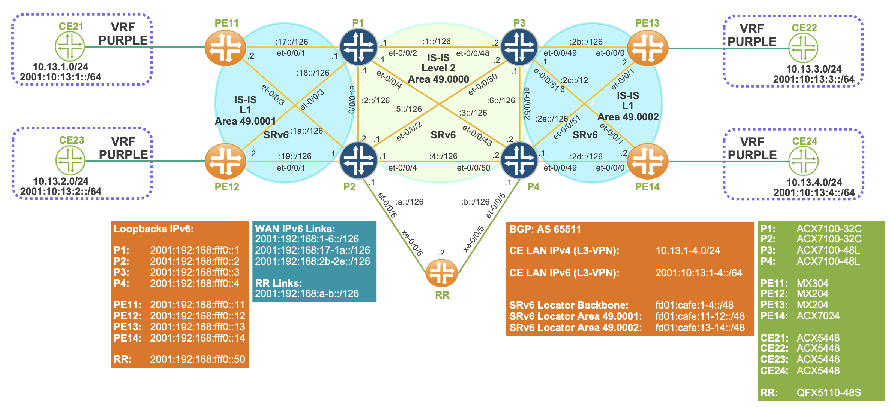
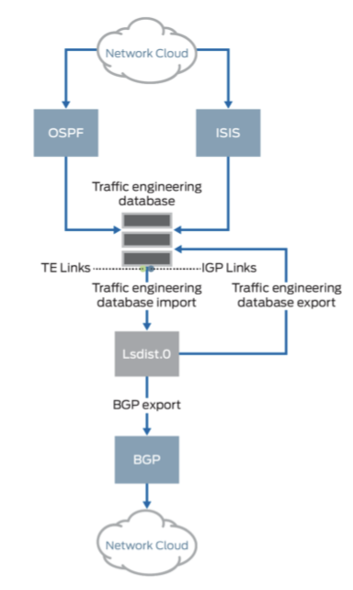
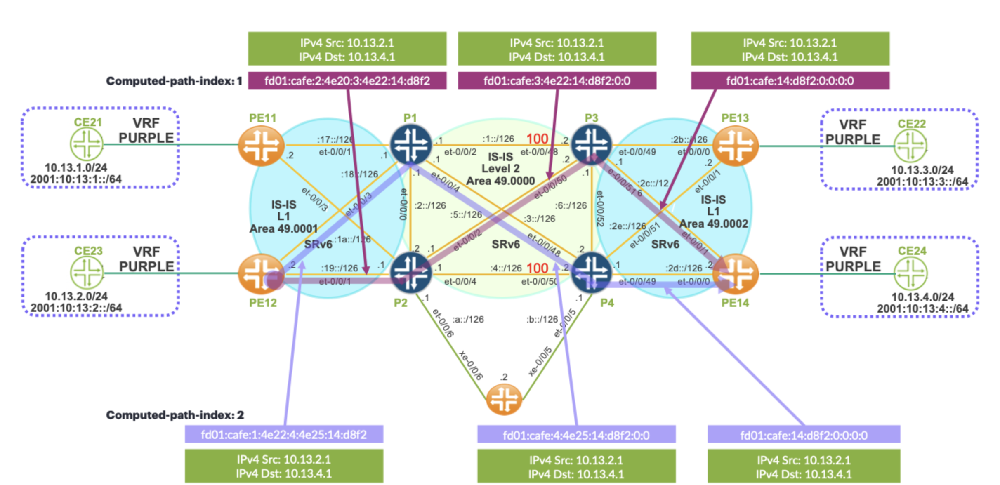
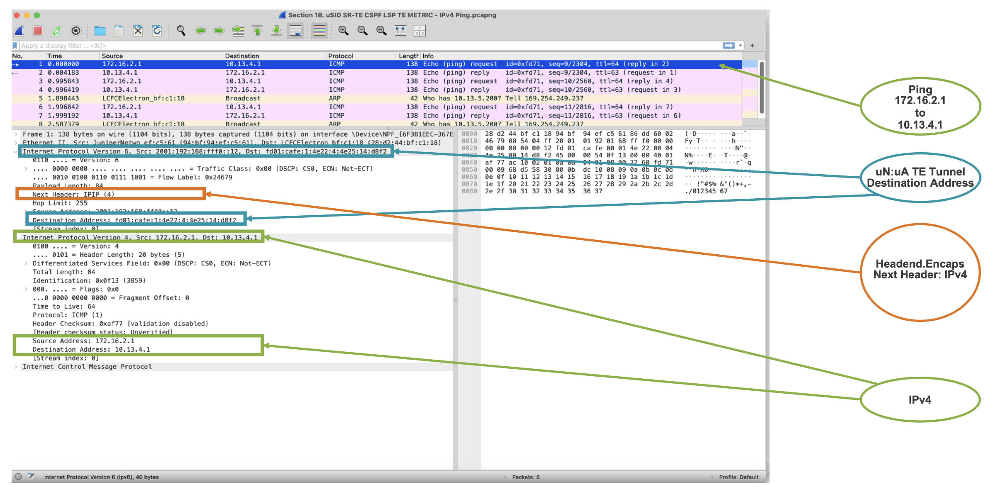
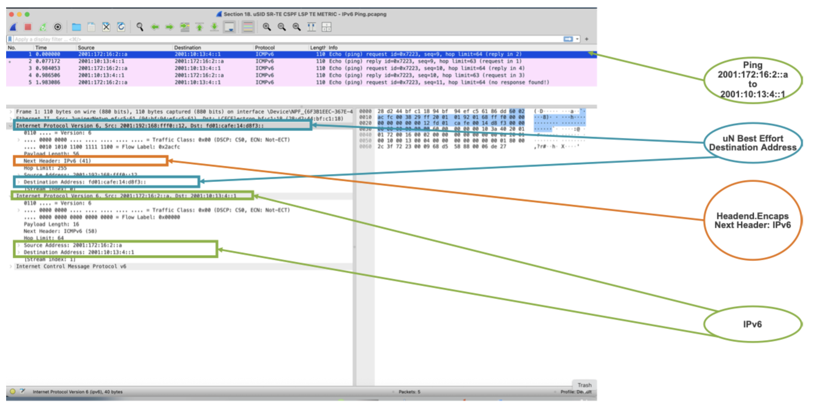
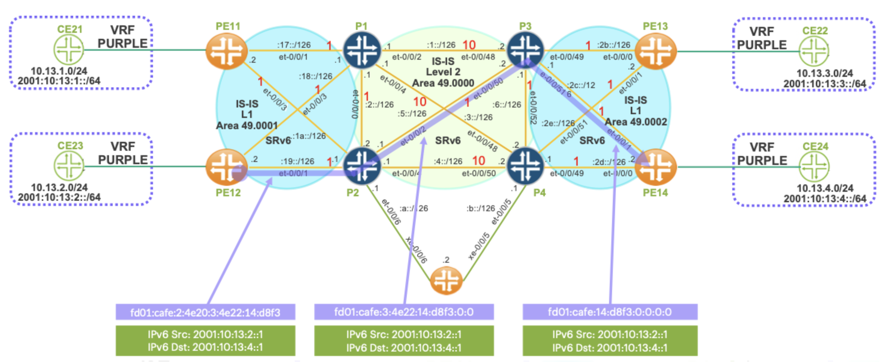
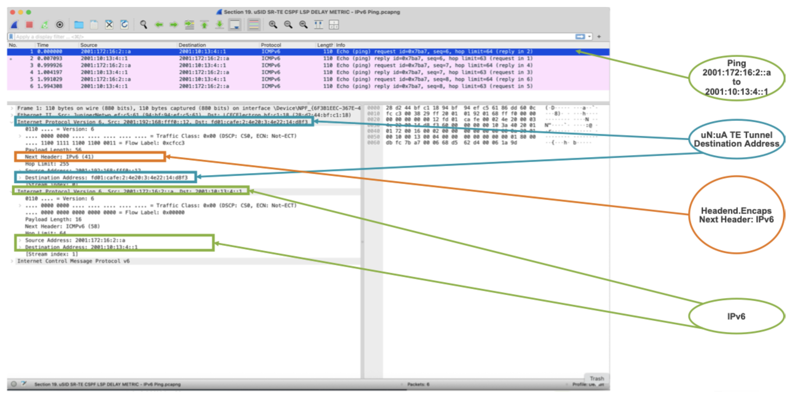
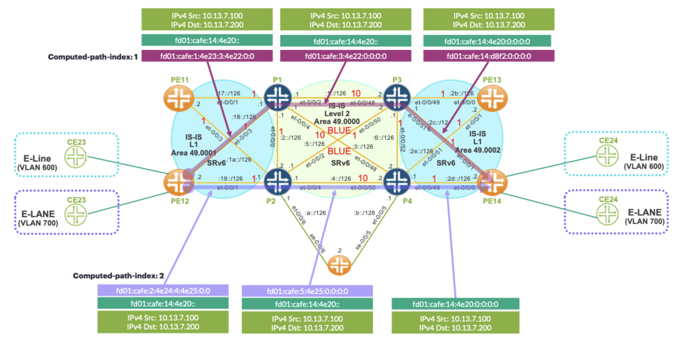
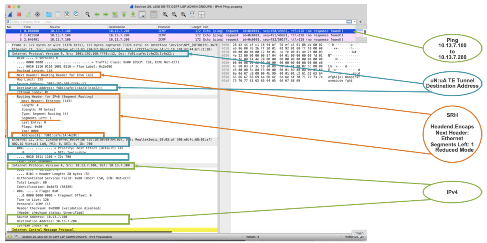

# Dynamic SRv6 TE Tunnels in a Multi-Domain Network

**Ricardo Dominguez - 2026-11-02**

This is the second post in our series on SRv6 TE tunnels. In the first post, we explored Static TE tunnels, examining their design principles and configuration workflows. We demonstrated how manually defined segment lists can be used to steer traffic along predetermined paths across the network.

In this second post, we shift our focus to SRv6 TE tunnels in multi-domain environments. We will explore how CSPF based path computation and automated traffic engineering mechanisms can enhance network resiliency, optimize traffic forwarding, and simplify operations across complex network topologies.

## Introduction

One of the primary limitations of static SRv6 TE tunnels is their operational fragility. Because the forwarding path is explicitly defined, a failure affecting any intermediate node or link can disrupt the intended traffic path. Although underlying protection mechanisms, such as TI-LFA, can provide local recovery, the resulting traffic path may deviate from the operator’s original traffic-engineering policy. This can lead to suboptimal forwarding or compromise service-level guarantees.

As a result, static SRv6 TE tunnels provide a high degree of control but limited adaptability. Ensuring resiliency in these deployments often requires additional engineering effort, including designing backup segment lists, configuring secondary TE policies, implementing protection mechanisms, and establishing operational procedures to adjust paths manually during failures or maintenance events. As networks grow in scale and complexity, this operational overhead can become increasingly difficult to manage. Consequently, many service providers complement or replace static paths with dynamic SRv6 TE mechanisms orchestrated through CSPF computations or centralized WAN controllers.

Throughout this technical blog series, we will explore the deployment and operation of dynamic CSPF SRv6 TE tunnels in the Junos OS, with particular emphasis on the associated control-plane requirements. Our goal is to examine how Dynamic SRv6 TE tunnels can be constructed and enforced using SID structures and traffic-engineering techniques, while discussing the operational considerations associated with each approach.

We will cover several implementations of dynamic SRv6 TE tunnels, including:

- Dynamic TE tunnels based on the TE metric 
- Dynamic TE tunnels based on the Static Delay metric 
- Dynamic TE tunnels based on the Static Delay metric combined with admin groups

A fundamental component of dynamic path computation is the Traffic Engineering Database , which maintains network topology information and traffic-engineering attributes learned through the IGP. In IS-IS environments, it is essential to understand that the TED is maintained independently for each IS-IS level. This distinction becomes particularly important in multi-domain deployments, where individual routers do not automatically have a complete, end-to-end view of the network topology across multiple IS-IS levels.

To establish dynamic SRv6 TE tunnels across a multi-domain IS-IS network, topology information must therefore be made available beyond the boundaries of a single level. Two common approaches can address this requirement:

- Using a centralized WAN Controller, such as Juniper Networks Routing Director, which collects topology information and computes end-to-end SRv6 TE paths centrally 
- Leveraging BGP-LS as a distributed topology dissemination mechanism, where BGP-LS Producers (typically L1/L2 routers) advertise TED information toward BGP-LS Consumers (such as ingress PE routers), often through Route Reflectors 

These approaches enable routers or controllers to build a unified topology view across multiple IS-IS domains, making dynamic SRv6 TE path computation possible even in complex, large-scale service provider environments.

We will focus specifically on the second approach: controllerless multi-domain SRv6 TE using BGP-LS based TED distribution. We will explore how BGP-LS can provide scalable topology dissemination across IS-IS levels, how ingress routers can leverage this information for dynamic CSPF based path computation, and how this architecture enables advanced SRv6 Traffic Engineering without relying on an external centralized controller.

## Test Topology

Our test topology is based on a multi-domain IS-IS architecture designed to demonstrate SRv6 Traffic Engineering across Level 1 and Level 2 domains. In this design, the backbone functions as a Level 2 transport core, while the edge and access networks are organized into distinct Level 1 areas.

This hierarchical design allows us to examine how SRv6 TE policies behave not only within a single IS-IS domain, but also across multiple areas where topology visibility and Traffic Engineering Database distribution become important operational considerations.

### Level 2 Backbone Area

The core of the topology consists of routers P1, P2, P3, and P4, which are interconnected within IS-IS Level 2 Area 49.0000.

These routers form the transport backbone of the network and provide inter-area connectivity between the different Level 1 domains. As Level 2 routers, they maintain the backbone topology and are responsible for forwarding traffic between the various edge regions of the network.  Within this backbone, SRv6 segment routing information and Traffic Engineering attributes are propagated through IS-IS extensions.

### Level 1 Edge Areas

Two separate Level 1 areas are connected to the Level 2 backbone:
- Level 1 Area 49.0001 
- Level 1 Area 49.0002 

In Area 49.0001:
- Router PE11 connects to backbone routers P1 & P2
- Router PE12 connects to backbone routers P1 & P2 

These routers represent ingress and egress Provider Edge devices located within the same Level 1 domain. They rely on the Level 2 backbone for connectivity toward destinations located outside their local area.

In Area 49.0002:
- Router PE13 connects to backbone routers P3 & P4
- Router PE14 connects to backbone routers P3 & P4 

This second Level 1 domain represents another edge region of the network connected through the shared Level 2 core.

The separation into multiple Level 1 areas allows us to simulate realistic multi-domain SRv6 TE scenarios, where routers do not inherently possess full topology visibility across all IS-IS levels. 

This topology will serve as the foundation for the upcoming configuration examples and SRv6 TE demonstrations throughout the series.



This network topology is built on an IPv6 native underlay and no IPv4 routing exists within the underlay, where IS-IS is used as the interior gateway protocol for routing and topology dissemination across the infrastructure. The design leverages SRv6 as the primary tunneling and traffic engineering technology, enabling source-routing capabilities directly within the IPv6 data plane. This allows end-to-end packet steering across the network without requiring traditional MPLS labels while maintaining strong traffic engineering control.

Within this architecture, BGP plays a critical role at the service layer rather than the transport layer. It is used between PE routers and RRs to distribute IPv4 and IPv6 VPN routes, including support for SRv6-enabled VPN extensions. This enables the delivery of Layer 3 VPN services over the SRv6 underlay, allowing customer traffic to be properly segmented and routed across the provider network while maintaining isolation between tenants.

A key design characteristic of this topology is that it operates as a BGP free core. The backbone network does not rely on BGP for internal routing decisions or reachability. Instead, all core routing is handled exclusively by IS-IS, which maintains the IPv6 underlay topology. This significantly reduces control-plane complexity within the core, as BGP is completely confined to the edge and service layer functions on the PE routers.

Although the core is IPv6 only and BGP-free, the network still supports full Layer 3 VPN services across all PE routers. These VPN services provide connectivity for both IPv4 and IPv6 customer traffic originating from CE devices. The PE routers act as service edge points where customer routes are learned via BGP, placed into VRFs, and then transported across the SRv6 enabled IPv6 core. This ensures that both IPv4 and IPv6 VPN traffic can be carried transparently over a unified SRv6 underlay, combining service flexibility with a simplified, protocol-minimized core design.

## Hardware Used

We are utilizing the following HPE Juniper hardware in our test bed topology to build a realistic and production-representative SRv6-enabled service provider environment.

- **P1:** ACX7100-32C
- **P2:** ACX7100-32C
- **P3:** ACX7100-48L
- **P4:** ACX7100-48L
- **PE11:** MX304
- **PE12:** MX204
- **PE13:** MX204
- **PE14:** ACX7024
- **CE21:** ACX5448
- **CE22:** ACX5448
- **CE23:** ACX5448
- **CE24:** ACX5448
- **RR:** QFX5110-48S

## SRv6

Before deploying a SRv6 TE tunnels we need to enable SRv6 in the network infrastructure and BGP based services.

For our network, the following SRv6 attributes need to be enable:

- SRv6 Locator Block: Our network is based on fd01:cafe::/32 locator block
- SRv6 Locator Node: The Node Index ID is assigned to our routers in a manner that corresponds to their respective identifiers, specifically matching the digits of PE or P routers. 

```plaintext
PE11:	11		P1:	1
PE12:	12		P2:	2
PE13:	13		P3:	3
PE14:	14		P4:	4
```

- Advertise the SRv6 Locator Prefix in IS-IS
- Enable uA on the IS-IS interfaces

For SRv6 locator addressing, there are two commonly accepted approaches: Unique Local Address  space (fc00::/7) or RFC 9602. 

In our implementation, we choose to use ULA space, specifically a prefix derived from fd00::/8. According to RFC 4193, ULA prefixes require the least significant bit of the first octet to be 1.

The SRv6 configuration and operational verification for PE12 are covered in detail in the first post of this technical blog series: https://techpost.hpe.com/articles/srv6-static-lsps/article

All other PE and P routers follow the same configuration model, with only the node ID and interface-specific parameters differing between devices. 

## Traffic Engineering Database

Dynamic Traffic Engineering tunnels do not rely directly on the Link-State Database for path computation. Instead, they use the Traffic Engineering Database, which contains the topology information and TE attributes required to calculate traffic-engineered paths. 

TE attributes are typically advertised through the IGP and stored in the LSDB, from where they can be imported into the TED. In addition, TE information learned through BGP-LS can be incorporated into the TED, providing supplementary topology and traffic-engineering attributes for path computation.
It is important to distinguish the TED from the LSDB. While the LSDB maintains IGP link-state information, the TED serves as the repository of topology and TE attributes used for traffic engineering path calculations. Both IGP protocols and BGP-LS can contribute TE information to the TED.
IGP

Both OSPF and IS-IS maintain TED information within their respective OSPF areas or IS-IS levels. However, populating the TED is not automatic and requires specific configuration. This functionality relies on IGP Traffic Engineering extensions, which enable routers to advertise TE link attributes such as TE metrics, delay metrics, and administrative groups.

On Junos OS, enabling the “l3-unicast-topology" knob under IS-IS Traffic Engineering allows the IGP's Layer 3 unicast topology information to be downloaded into the TED. This topology information, together with TE attributes advertised by other routers, provides the necessary input for Segment Routing to perform TE path computation and establish SRv6 TE tunnels.

The “Advertisement always" knob under IS-IS traffic engineering ensures that TE information continues to be advertised, allowing the relevant attributes to be propagated for Segment Routing Traffic Engineering.

The following configuration is required to populate TED per IS-IS level.

```plaintext
protocols {
    isis {
        traffic-engineering {
            l3-unicast-topology;
            ipv6;
            advertisement always;
        }
    }
}
```

When configuring a dynamic SRv6 TE tunnel across multiple IS-IS levels or domains, tunnel establishment will fail because the TED contains topology information specific to each level or domain, rather than a complete end-to-end view of the network. We can verify this behavior using the operational checks outlined below.
In this example, we attempt to establish a dynamic SRv6 TE tunnel from PE12 to PE14 across multiple domains.

```plaintext
jnpr@MX204-PE12# run show spring-traffic-engineering lsp 
To                        State        LSPname
2001:192:168:fff0::14-300<c6>    Down         PE12_to_PE14_COLOR_300

jnpr@MX204-PE12# run show spring-traffic-engineering lsp detail | no-more 
E = Entropy-label Capability

Name: PE12_to_PE14_COLOR_300
  Tunnel-source: Static configuration
  Tunnel Forward Type: SRV6
  To: 2001:192:168:fff0::14-300<c6>
  From: 2001:192:168:fff0::12
  State: Down
    Path: PATH_PE12_to_PE14_COLOR_300
    Path Status: NA
    Outgoing interface: NA
    Auto-translate status: Disabled Auto-translate result: N/A
    Compute Status:Enabled , Compute Result:failure , Compute-Profile Name:N/A
    Total number of computed paths: 0
```

A closer inspection of PE12’s TED reveals that it contains topology information only for IS-IS Level 1 area 49.0001, with no visibility into other levels or domains. Consequently, PE12 cannot compute an end-to-end path across multiple IS-IS levels or domains. This behavior is expected because the TED maintains topology information specific to each IS-IS level or domain.

```plaintext
jnpr@MX204-PE12# run show ted database topology-type l3-unicast | no-more 
TED database: 4 ISIS nodes 4 INET nodes 4 INET6 nodes
ID                            Type Age(s) LnkIn LnkOut Protocol      MI  MT
ACX7100-32C-P1.00(192.168.0.1)(2001:192:168:fff0::1) Rtr   1642     3      3 IS-IS(1) 0 0  
                                                       IS-IS(1)      0   2  
    To: MX304-PE11.00(192.168.0.11)(2001:192:168:fff0::11), Local: 192.168.7.1, Remote: 0.0.0.0
      IPv6 Local: 2001:192:168:17::1, IPv6 Remote: 2001:192:168:17::2
      Local interface index: 1004, Remote interface index: 339
    To: ACX7100-32C-P2.00(192.168.0.2)(2001:192:168:fff0::2), Local: 192.168.2.1, Remote: 0.0.0.0
      IPv6 Local: 2001:192:168:2::1, IPv6 Remote: 2001:192:168:2::2
      Local interface index: 1003, Remote interface index: 1003
    To: MX204-PE12.00(192.168.0.12)(2001:192:168:fff0::12), Local: 192.168.8.1, Remote: 0.0.0.0
      IPv6 Local: 2001:192:168:18::1, IPv6 Remote: 2001:192:168:18::2
      Local interface index: 1006, Remote interface index: 338
ID                            Type Age(s) LnkIn LnkOut Protocol      MI  MT
ACX7100-32C-P2.00(192.168.0.2)(2001:192:168:fff0::2) Rtr   1639     3      3 IS-IS(1) 0 0  
                                                       IS-IS(1)      0   2  
    To: MX304-PE11.00(192.168.0.11)(2001:192:168:fff0::11), Local: 192.168.10.1, Remote: 0.0.0.0
      IPv6 Local: 2001:192:168:1a::1, IPv6 Remote: 2001:192:168:1a::2
      Local interface index: 1006, Remote interface index: 341
    To: ACX7100-32C-P1.00(192.168.0.1)(2001:192:168:fff0::1), Local: 192.168.2.2, Remote: 0.0.0.0
      IPv6 Local: 2001:192:168:2::2, IPv6 Remote: 2001:192:168:2::1
      Local interface index: 1003, Remote interface index: 1003
    To: MX204-PE12.00(192.168.0.12)(2001:192:168:fff0::12), Local: 192.168.9.1, Remote: 0.0.0.0
      IPv6 Local: 2001:192:168:19::1, IPv6 Remote: 2001:192:168:19::2
      Local interface index: 1004, Remote interface index: 337
ID                            Type Age(s) LnkIn LnkOut Protocol      MI  MT
MX304-PE11.00(192.168.0.11)(2001:192:168:fff0::11) Rtr   1664     2      2 IS-IS(1) 0 0  
                                                       IS-IS(1)      0   2  
    To: ACX7100-32C-P1.00(192.168.0.1)(2001:192:168:fff0::1), Local: 192.168.7.2, Remote: 0.0.0.0
      IPv6 Local: 2001:192:168:17::2, IPv6 Remote: 2001:192:168:17::1
      Local interface index: 339, Remote interface index: 1004
    To: ACX7100-32C-P2.00(192.168.0.2)(2001:192:168:fff0::2), Local: 192.168.10.2, Remote: 0.0.0.0
      IPv6 Local: 2001:192:168:1a::2, IPv6 Remote: 2001:192:168:1a::1
      Local interface index: 341, Remote interface index: 1006
ID                            Type Age(s) LnkIn LnkOut Protocol      MI  MT
MX204-PE12.00(192.168.0.12)(2001:192:168:fff0::12) Rtr   1645     2      2 IS-IS(1) 0 0  
                                                       IS-IS(1)      0   2  
    To: ACX7100-32C-P2.00(192.168.0.2)(2001:192:168:fff0::2), Local: 192.168.9.2, Remote: 0.0.0.0
      IPv6 Local: 2001:192:168:19::2, IPv6 Remote: 2001:192:168:19::1
      Local interface index: 337, Remote interface index: 1004
    To: ACX7100-32C-P1.00(192.168.0.1)(2001:192:168:fff0::1), Local: 192.168.8.2, Remote: 0.0.0.0
      IPv6 Local: 2001:192:168:18::2, IPv6 Remote: 2001:192:168:18::1
      Local interface index: 338, Remote interface index: 1006
```

### BGP LS

From a TE perspective, multi-domain refers to multiple OSPF areas or instances, multiple IS-IS levels or instances, and multiple BGP autonomous systems. 

BGP-LS enables Traffic Engineering node, link, and prefix information to be distributed across multiple domains or autonomous systems, facilitating TE tunnels computation across multiple domains. By leveraging BGP’s proven scalability and policy-based distribution mechanisms, BGP-LS provides an effective solution for disseminating topology information throughout large, complex networks.

RFC 9514 defines extensions for BGP-LS to support the advertisement of SRv6 information.

These extensions define how SRv6-related information is encoded and conveyed through BGP-LS attributes, as illustrated in the table below.

Table: ISIS TLV / BGP LS Attribute

| IS-IS TLV | BGP-LS Attribute |
|---|---|
| SRv6 Capabilities | Node Attribute |
| SRv6 Locator | Prefix Attribute |
| SRv6 End SID Sub-TLV | Prefix Attribute |
| SRv6 SID Structure Sub-TLV | Prefix or Link Attribute, as applicable |
| SRv6 End.X SID Sub-TLV | Link Attribute |

Within this architecture, BGP-LS Producers, such as L1/L2 Routers, advertise their locally available TED information through BGP-LS, typically toward a BGP Route Reflector. From the perspective of the “lsdist0", this corresponds to importing TED information for BGP-LS distribution.

BGP-LS Consumers, such as ingress PE routers, receive and import the advertised BGP-LS information. From the perspective of “lsdist0", this corresponds to exporting the received topology information into the TED, making it available for dynamic path computation across multiple domains.

TED import or export is considered from the lsdist0 perspective, as shown in Figure 2.



Based on our topology, the BGP-LS and TED import/export configuration for P1, PE12, and the Route Reflector is shown. The same configuration applies to the other P and PE routers.

**P1**
```plaintext
policy-options {
    policy-statement ISIS-TE {
        term 1 {
            from protocol isis;
            to family traffic-engineering;
            then accept;
    }}
    policy-statement TED-TO-BGP-LS {
        term IMPORT_TED {
            from family traffic-engineering;
            then accept;
}}}
protocols {
    bgp {
        group INTERNO {
            type internal;
            local-address 192.168.0.1;
            family traffic-engineering {
                unicast;
            }
            export TED-TO-BGP-LS;
            neighbor 192.168.0.50 {
                description RR;
    }}}
    mpls {
        traffic-engineering {
            database {
                import {
                    l3-unicast-topology {
                        bgp-link-state;
                    }
                    policy ISIS-TE;
                    ipv6;
}}}}}
```

**PE12**
```plaintext
policy-options {
    policy-statement FROM_LSDIST0_TO_TED {
        term 1 {
            from family traffic-engineering;
            then accept;
        }}}
protocols {
    bgp {
        group INTERNO {
            type internal;
            local-address 192.168.0.12;
            family traffic-engineering {
                unicast;
            }
            neighbor 192.168.0.50 {
                description RR;
            }}}
    mpls {
        traffic-engineering {
            database {
                export {
                    policy FROM_LSDIST0_TO_TED;
                    l3-unicast-topology;
}}}}}
```

**Route Reflector**
```plaintext
protocols {
    bgp {
        group INTERNO {
            type internal;
            local-address 192.168.0.50;
            family traffic-engineering {
                unicast;
            }
            cluster 192.168.0.50;
            neighbor 192.168.0.1 {
                description P1;
            }
            neighbor 192.168.0.12 {
                description PE12;
}}}}
```

The Route Reflector receives BGP-LS routes from the P routers, which in this case are our BGP-LS producers.

```plaintext
jnpr@QFX5110-48S-RR# run show bgp summary                     
Threading mode: BGP I/O
Default eBGP mode: advertise - accept, receive - accept
Groups: 2 Peers: 12 Down peers: 0
Table          Tot Paths  Act Paths Suppressed    History Damp State    Pending
lsdist.0             
                     736        359          0          0          0          0
Peer                     AS      InPkt     OutPkt    OutQ   Flaps Last Up/Dwn State|#Active/Received/Accepted/Damped...
192.168.0.1           65511        104        116       0       0       26:07 Establ
  lsdist.0: 86/181/181/0
192.168.0.2           65511        104        141       0       0       26:07 Establ
  lsdist.0: 86/181/181/0
192.168.0.3           65511        106        132       0       0       26:07 Establ
  lsdist.0: 0/187/187/0
192.168.0.4           65511        106         99       0       0       26:07 Establ
  lsdist.0: 187/187/187/0
192.168.0.11          65511         60        126       0       0       26:04 Establ
  lsdist.0: 0/0/0/0
192.168.0.12          65511         60        143       0       0       26:07 Establ
  lsdist.0: 0/0/0/0
192.168.0.13          65511         60        143       0       0       26:07 Establ
  lsdist.0: 0/0/0/0
192.168.0.14          65511         60        143       0       0       26:06 Establ
  lsdist.0: 0/0/0/0
```

PE12 is our BGP-LS consumer and is receiving BGP-LS node, link, and prefix routes corresponding to other IS-IS levels from the Route Reflector.

```plaintext
jnpr@MX204-PE12# run show bgp summary 
Threading mode: BGP I/O
Default eBGP mode: advertise - accept, receive - accept
Groups: 3 Peers: 4 Down peers: 0
Table          Tot Paths  Act Paths Suppressed    History Damp State    Pending
lsdist.0             
                     273        273          0          0          0          0
Peer                     AS      InPkt     OutPkt    OutQ   Flaps Last Up/Dwn State|#Active/Received/Accepted/Damped...
192.168.0.50          65511        109         22       0       2        9:33 Establ
  lsdist.0: 273/273/273/0

jnpr@MX204-PE12# run show route table lsdist.0 | no-more 
lsdist.0: 273 destinations, 273 routes (273 active, 0 holddown, 0 hidden)
+ = Active Route, - = Last Active, * = Both
NODE { AS:65511 ISO:1921.6800.0014.00 ISIS-L1:0 }/1536              
                   *[BGP/170] 00:09:32, localpref 100, from 192.168.0.50
                      AS path: I, validation-state: unverified
                    >  to 192.168.9.1 via et-0/0/1.0
                       to 192.168.8.1 via et-0/0/3.0
LINK { Local { AS:65511 ISO:1921.6800.0004.00 }.{ IPv4:192.168.13.1 } Remote { AS:65511 ISO:1921.6800.0014.00 }.{ MT-ID:2 } ISIS-L1:0 }/1536              
                   *[BGP/170] 00:09:32, localpref 100, from 192.168.0.50
                      AS path: I, validation-state: unverified
                    >  to 192.168.9.1 via et-0/0/1.0
                       to 192.168.8.1 via et-0/0/3.0
PREFIX { Node { AS:65511 ISO:1921.6800.0014.00 } { IPv4:192.168.0.14/32 } ISIS-L1:0 }/1536              
                   *[BGP/170] 00:09:33, localpref 100, from 192.168.0.50
                      AS path: I, validation-state: unverified
                    >  to 192.168.9.1 via et-0/0/1.0
                       to 192.168.8.1 via et-0/0/3.0
IPV6 PREFIX { Node { AS:65511 ISO:1921.6800.0001.00 } { IPv6:fd01:cafe:14::/48 MT-ID:2 } ISIS-L1:0 }/1536              
                   *[BGP/170] 00:09:33, localpref 100, from 192.168.0.50
                      AS path: I, validation-state: unverified
                    >  to 192.168.8.1 via et-0/0/3.0
SRV6 END SID { Node { AS:65511 ISO:1921.6800.0001.00 } { END SID:fd01:cafe:14:: MT-ID:2 } ISIS-L1:0 }/1536              
                   *[BGP/170] 00:09:33, localpref 100, from 192.168.0.50
                      AS path: I, validation-state: unverified
                    >  to 192.168.8.1 via et-0/0/3.0
```

PE’s TED is populated with TE information from other IS-IS levels.

```plaintext
jnpr@MX204-PE12# run show ted database topology-type l3-unicast | no-more 
TED database: 9 ISIS nodes 9 INET nodes 4 INET6 nodes
ID                            Type Age(s) LnkIn LnkOut Protocol      MI  MT
1921.6800.0003.00(192.168.0.3) Rtr    574     5      5 Exported ISIS-L2(2) 0 0  
                                                       Exported ISIS-L2(2) 0 2  
    To: 1921.6800.0004.00(192.168.0.4), Local: 192.168.6.1, Remote: 0.0.0.0
      Local interface index: 0, Remote interface index: 0
    To: ACX7100-32C-P2.00(192.168.0.2)(2001:192:168:fff0::2), Local: 192.168.5.2, Remote: 0.0.0.0
      Local interface index: 0, Remote interface index: 0
    To: ACX7100-32C-P1.00(192.168.0.1)(2001:192:168:fff0::1), Local: 192.168.1.2, Remote: 0.0.0.0
      Local interface index: 0, Remote interface index: 0
ID                            Type Age(s) LnkIn LnkOut Protocol      MI  MT
                                                       Exported ISIS-L1(4) 0 0  
                                                       Exported ISIS-L1(4) 0 2  
    To: 1921.6800.0004.00(192.168.0.4), Local: 192.168.6.1, Remote: 0.0.0.0
      Local interface index: 0, Remote interface index: 0
    To: 1921.6800.0014.00(192.168.0.14), Local: 192.168.12.1, Remote: 0.0.0.0
      Local interface index: 0, Remote interface index: 0
    To: 1921.6800.0013.00(192.168.0.13), Local: 192.168.11.1, Remote: 0.0.0.0
      Local interface index: 0, Remote interface index: 0
ID                            Type Age(s) LnkIn LnkOut Protocol      MI  MT
1921.6800.0014.00(192.168.0.14) Rtr    574     2      2 Exported ISIS-L1(4) 0 0  
                                                       Exported ISIS-L1(4) 0 2  
    To: 1921.6800.0004.00(192.168.0.4), Local: 192.168.13.2, Remote: 0.0.0.0
      Local interface index: 0, Remote interface index: 0
    To: 1921.6800.0003.00(192.168.0.3), Local: 192.168.12.2, Remote: 0.0.0.0
      Local interface index: 0, Remote interface index: 0

jnpr@MX204-PE12# run show ted database topology-type l3-unicast extensive | no-more 
TED database: 9 ISIS nodes 9 INET nodes 4 INET6 nodes
NodeID: 1921.6800.0014.00(192.168.0.14)
  Type: Rtr, Age: 574 secs, LinkIn: 2, LinkOut: 2
  Protocol: Exported ISIS-L1(4), MI: 0, MT: 0
   192.168.0.14
   Prefixes: 
     192.168.0.14/32
   SRV6 Locators: 
   SPRING-Algorithms:
     Algo: 0
     Algo: 1
   SRV6 Capable: - Flags: 0
   Node MSD:
      - Type: 1, Value: 0
      - Type: 2, Value: 14
      - Type: 41, Value: 12
      - Type: 42, Value: 7
      - Type: 43, Value: 10
      - Type: 44, Value: 12
      - Type: 45, Value: 9
  Protocol: Exported ISIS-L1(4), MI: 0, MT: 2
   192.168.0.14
    To: 1921.6800.0004.00(192.168.0.4), Local: 192.168.13.2, Remote: 0.0.0.0
      Local interface index: 0, Remote interface index: 0
      Metric: 10
      IGP metric: 10
      Static BW: 100Gbps
      Interface Switching Capability Descriptor(1):
        Switching type: Packet
        Encoding type: Packet
        Maximum LSP BW [priority] bps:
          [0] 0bps         [1] 0bps        [2] 0bps        [3] 0bps        
          [4] 0bps         [5] 0bps        [6] 0bps        [7] 0bps        
      SRV6 END.X SID:
        P2P SRV6 END-X-SID:SID: fd01:cafe:14:d8f0::, Flags: --P, Weight: 0, Algorithm: 0, Flavor: PSP, USD
          SID Structure: LB Length - 32, LN Length - 16, Function Length - 16, Argument Length - 64
      Link MSD:
         - Type: 1, Value: 0
    To: 1921.6800.0003.00(192.168.0.3), Local: 192.168.12.2, Remote: 0.0.0.0
      Local interface index: 0, Remote interface index: 0
      Metric: 10
      IGP metric: 10
      Static BW: 100Gbps
      Interface Switching Capability Descriptor(1):
        Switching type: Packet
        Encoding type: Packet
        Maximum LSP BW [priority] bps:
          [0] 0bps         [1] 0bps        [2] 0bps        [3] 0bps        
          [4] 0bps         [5] 0bps        [6] 0bps        [7] 0bps        
      SRV6 END.X SID:
        P2P SRV6 END-X-SID:SID: fd01:cafe:14:d8f1::, Flags: --P, Weight: 0, Algorithm: 0, Flavor: PSP, USD
          SID Structure: LB Length - 32, LN Length - 16, Function Length - 16, Argument Length - 64
      Link MSD:
         - Type: 1, Value: 0
   Prefixes: 
     2001:192:168:2c::/126
      Metric: 10
     2001:192:168:2d::/126
      Metric: 10
     2001:192:168:fff0::14/128
     fd01:cafe:14::/48
   SRV6 Locators: 
     fd01:cafe:14::/48, Metric: 0, Flags: 0x0, Algorithm: 0
       fd01:cafe:14::, 0x00, PSP_USD
         SID Structure: LB Length - 32, LN Length - 16, Function Length - 0, Argument Length - 80
```

In this architecture, BGP-LS distributes topology information across the network, providing routers with a unified TED that enables PE routers to establish multi-domain TE tunnels. 

## Dynamic SRv6 TE Tunnels

RFC 9256 specifies the architecture of Segment Routing Policies, which provide a mechanism for steering traffic along specific paths within an SR network. According to this RFC, an SR Policy is defined by a three-element tuple:

- **Headend**: the ingress router where the policy is instantiated 
- **Color**: a numeric identifier representing the service or TE intent (carried via BGP community) 
- **Endpoint**: the destination node of the traffic flow 

The egress PE marks each BGP route with a **color community**, which represents the desired traffic-engineering intent. At the ingress PE, this color, together with the route’s **protocol next hop **is used to identify and bind the route to an SR Policy that matches the same color and endpoint.

Dynamic SRv6 tunnels provide greater inherent resilience by allowing the system to dynamically adapt to changes in CSPF. If an eligible resource becomes unavailable due to a failure, maintenance activity, or a change in network conditions, the system can automatically select an alternative resource that satisfies the same eligibility criteria. This flexibility helps maintain service continuity and reduces the need for manual intervention when the network topology or resource availability changes.
Although this approach allows the overall path to be influenced by defining the selection criteria and constraints, it does not provide explicit control over the exact sequence in which different types of regions or resources are traversed. The system determines the order of traversal based on the available resources and the configured criteria. Consequently, while the desired path characteristics can be specified, the precise arrangement of the different regions or resources along the path cannot be strictly enforced. This represents a trade-off between operational flexibility and resilience on one hand, and fine-grained control over path construction on the other.

We will cover 3 different implementations of dynamic SRv6 TE tunnels, including:

- Dynamic TE tunnels based on the TE metric 
- Dynamic TE tunnels based on the Static Delay metric 
- Dynamic TE tunnels based on the Static Delay metric combined with admin groups

### Dynamic TE tunnels based on the TE metric 

This SRv6 Traffic Engineering tunnel will use the TE metric as the criteria for path calculation and selection. 

By default, dynamically established SRv6 TE tunnels use TE metrics to determine the optimal path through the network. If a TE metric is not explicitly configured on an individual link, the corresponding IGP metric is automatically inherited and used as the TE metric for that link. This behavior ensures that the tunnel path can be calculated dynamically based on the existing IGP metric values. However, if specific TE metrics are configured, those values will be used for path computation.

Before configuring the SRv6 Traffic Engineering tunnel, we will first establish the TE metric values for specific links in the network to influence the subsequent path computation. As illustrated in figure 3, a TE metric of 100 will be configured on the link between P1 and P3, as well as on the link between P2 and P4. These values will be used by the SRv6 TE path computation process to evaluate the cost of traversing these links and determine the most appropriate path according to the TE metrics.
The remaining WAN links will retain their default TE metric behaviour, whereby the TE metric is inherited from the corresponding IGP metric when no explicit TE metric is configured. In this scenario, these links will have an IGP metric of 10, calculated based on a reference bandwidth of 1 Tbps and a link bandwidth of 100 Gbps.
The SRv6 TE tunnel will be established with PE12 as the headend node and PE14 as the endpoint, using color 129 to identify the intended traffic engineering policy. During the path computation process, PE12 will calculate two ECMP paths based on the configured TE metrics across the WAN topology.

As illustrated in Figure 3, both paths will be considered eligible for carrying traffic because they have equivalent TE costs according to the configured metrics. This allows the SRv6 TE tunnel to leverage multiple paths simultaneously, providing load-sharing capabilities while maintaining the intended traffic engineering objectives.
The two computed paths are described below:

- Path 1: PE12 > P2 > P3 > PE14
- Path 2: PE12 > P1 > P4 > PE14

With these two paths available, PE12 can distribute traffic across the ECMP paths toward PE14. 

The SRv6 TE tunnel will be named **“PE12_to_PE14_COLOR_129"** and associated with color 129, which identifies the intended traffic engineering policy. The tunnel path will be computed using a TE compute profile named **“TO_PE14_TE_METRIC"**, which defines the criteria used to calculate the optimal path based on the configured TE metrics across the network.

At the egress PE router, PE14, IPv4 prefixes belonging to the Purple VRF will be tagged with the BGP Color Extended Community value of 129. This color community allows the corresponding routes to be associated with the SRv6 TE policy identified by color 129, enabling traffic destined for these prefixes to be steered through the appropriate TE tunnel.

The complete configuration required to establish this SRv6 TE tunnel and apply the associated color-based routing behavior is provided below.

**PE12**
```plaintext
routing-options {
    transport-class {
        name 129 {
            color 129;
} } }
protocols {
    source-packet-routing {
        compute-profile TO_PE14_TE_METRIC {
            igp-topology ipv6-unicast;
            no-sid-stack-compression;
            metric-type {
                te;
            }
            srv6;
        }
        srv6;
        source-routing-path PE12_to_PE14_COLOR_129 {
            srv6;
            to 2001:192:168:fff0::14;
            color 129;
            primary {
                PATH_PE12_to_PE14_COLOR_129 {
                    compute {
                        TO_PE14_TE_METRIC;
        } } } }
        use-transport-class;
} }
policy-options {
    community color:0:129 members color:0:129;
}
```

**PE14**
```plaintext
policy-options {
    policy-statement VRF_PURPLE_IPv4_COLOR_129 {
        term 1 {
            from family inet;
            then {
                community add color:0:129;
                community add target:65511:100;
                accept;
            }
        }
    }
    community color:0:129 members color:0:129;
    community target:65511:100 members target:65511:100;
}
routing-instances {
    VRF_PURPLE {
        instance-type vrf;
        protocols {
            bgp {
                group CE24 {
                    type external;
                    as-override;
                    neighbor 172.16.4.2 {
                        family inet {
                            unicast;
                        }
                        peer-as 65500;
                    }
                    neighbor 2001:172:16:4::b {
                        family inet6 {
                            unicast;
                        }
                        peer-as 65500;
                } }
                source-packet-routing {
                    srv6 {
                        locator MICROSID_LOCATOR {
                            micro-dt4-sid 55538;
                            micro-dt6-sid 55539;
        } } } } }
        interface et-0/0/8.0;
        route-distinguisher 192.168.0.14:14;
        vrf-export [ VRF_PURPLE_IPv4_COLOR_129 VRF_PURPLE_IPv6_COLOR_130 ];
        vrf-target target:65511:100;
        vrf-table-label;
} }
```
 


The resulting SRv6 TE tunnel is successfully established and operational, as indicated by its Up state. The tunnel's forwarding path is constructed using uN and uA segments. 

This type of SRv6 TE tunnel leverages both node segments (uN) and adjacency segments (uA). The uN component represents the node identifier assigned to each router, while the uA component corresponds to the adjacency SID generated for each physical or logical interface. Together, the uN:uA format allows for precise steering at both the node and link level.

Each uN:uA segment is 32 bits in total, composed of 16 bits for the uN portion and 16 bits for the uA portion. Despite this combination, the segment remains routable because the uN portion ensures network-wide reachability, while the uA portion provides local adjacency-specific forwarding behavior.
Because these SIDs are reachable throughout the network, intermediate routers can process and forward SRv6 packets along the intended path without requiring every router to be explicitly configured as part of the TE policy. This ensures that the segments used by the tunnel can be resolved and reached through the existing routing infrastructure, providing the necessary connectivity for the SRv6 TE tunnel to operate as expected.
Starting at P1 or P2, each router processes the uN:uA segment using the “shift and forward" behavior. Finally, PE14 performs a USD operation, removing the IPv6 header and processing the decapsulated payload, which in this case is IPv4 traffic.

```plaintext
jnpr@MX204-PE12# run show spring-traffic-engineering lsp 
To                        State        LSPname
2001:192:168:fff0::14-129<c6> Up          PE12_to_PE14_COLOR_129

jnpr@MX204-PE12# run show spring-traffic-engineering lsp detail | no-more 
Name: PE12_to_PE14_COLOR_129
  Tunnel-source: Static configuration
  Tunnel Forward Type: SRV6
  To: 2001:192:168:fff0::14-129<c6>
  From: 2001:192:168:fff0::12
  State: Up
    Path: PATH_PE12_to_PE14_COLOR_129
    Compute Status:Enabled , Compute Result:success , Compute-Profile Name:TO_PE14_TE_METRIC
    IGP topology: ipv6-unicast
    Total number of computed paths: 2
    Computed-path-index: 1
      TE metric: 30, IGP metric: 30
      Metric optimized by type: TE
      computed segments count: 3
        computed segment : 1 (computed-adjacency-segment): 
          Micro SRv6 SID: fd01:cafe:12:4e25::
          source router-id: 2001:192:168:fff0::12, destination router-id: 2001:192:168:fff0::2
            SSTLV: BL: 32, NL: 16, FL: 16, AL: 64
            Endpoint Behavior: End.X with NEXT-CSID, PSP & USD
        computed segment : 2 (computed-adjacency-segment): 
          Micro SRv6 SID: fd01:cafe:2:4e20::
          source router-id: 2001:192:168:fff0::2, destination router-id: 192.168.0.3
            SSTLV: BL: 32, NL: 16, FL: 16, AL: 64
            Endpoint Behavior: End.X with NEXT-CSID, PSP & USD
        computed segment : 3 (computed-adjacency-segment): 
          Micro SRv6 SID: fd01:cafe:3:4e22::
          source router-id: 192.168.0.3, destination router-id: 192.168.0.14
            SSTLV: BL: 32, NL: 16, FL: 16, AL: 64
            Endpoint Behavior: End.X with NEXT-CSID, PSP & USD
    Computed-path-index: 2
      TE metric: 30, IGP metric: 30
      Metric optimized by type: TE
      computed segments count: 3
        computed segment : 1 (computed-adjacency-segment): 
          Micro SRv6 SID: fd01:cafe:12:4e26::
          source router-id: 2001:192:168:fff0::12, destination router-id: 2001:192:168:fff0::1
            SSTLV: BL: 32, NL: 16, FL: 16, AL: 64
            Endpoint Behavior: End.X with NEXT-CSID, PSP & USD
        computed segment : 2 (computed-adjacency-segment): 
          Micro SRv6 SID: fd01:cafe:1:4e22::
          source router-id: 2001:192:168:fff0::1, destination router-id: 192.168.0.4
            SSTLV: BL: 32, NL: 16, FL: 16, AL: 64
            Endpoint Behavior: End.X with NEXT-CSID, PSP & USD
        computed segment : 3 (computed-adjacency-segment): 
          Micro SRv6 SID: fd01:cafe:4:4e25::
          source router-id: 192.168.0.4, destination router-id: 192.168.0.14
            SSTLV: BL: 32, NL: 16, FL: 16, AL: 64
            Endpoint Behavior: End.X with NEXT-CSID, PSP & USD
```

The SRv6 TE tunnel is installed in the **junos-rti-tc-129.inet6.3** routing table and is established using the **SPRING-TE** protocol. The tunnel is configured with a protocol preference of 8.

This tunnel serves as the transport path for resolving the BGP Protocol Next Hop associated with routes that carry the same color community. By matching the route's color with the corresponding SRv6 TE policy, the network can associate eligible BGP routes with the intended TE tunnel and steer traffic through the path established by that policy.

```plaintext
jnpr@MX204-PE12# run show route table junos-rti-tc-129.inet6.3 
junos-rti-tc-129.inet6.3: 2 destinations, 2 routes (2 active, 0 holddown, 0 hidden)
+ = Active Route, - = Last Active, * = Both
2001:192:168:fff0::14/128
                   *[SPRING-TE/8] 00:23:31, metric 1, metric2 30
                    >  to fe80::2e4c:15ff:fe61:66a0 via et-0/0/1.0, SRV6-Tunnel, Dest: 2001:192:168:fff0::14-129<c6>
                       to fe80::2cc:34ff:fe9b:281c via et-0/0/3.0, SRV6-Tunnel, Dest: 2001:192:168:fff0::14-129<c6>

jnpr@MX204-PE12# run show route resolution scheme name junos-resol-schem-tc-129-v6-service 
Resolution scheme: junos-resol-schem-tc-129-v6-service
  AutoCreated 
  References: 1
  Mapping community: color:0:129 
  Resolution Tree: 0x1d3fd000, index: 23, Nodes: 12
  Policy: [__resol-schem-common-import-policy__]
  Contributing routing tables: junos-rti-tc-129.inet6.3 inet6.3
```

The IPv4 prefixes associated with the Purple VRF on PE14 are advertised with a BGP Color Extended Community value of 129. When these routes are received by PE12, the color community identifies the intended traffic engineering policy, allowing their next-hop resolution to use the SRv6 TE tunnel established between PE12 and PE14 and associated with color 129. This enables IPv4 traffic destined for the Purple VRF prefixes to be steered through the designated SRv6 TE path, in accordance with the configured traffic engineering policy.

In contrast, the IPv6 prefixes associated with the Purple VRF on PE14 are received without a BGP color community. Consequently, these routes are not associated with the color-129 SRv6 TE policy. Instead, their SRv6 locator resolution relies on the inet6.3 routing table, which provides the relevant IPv6 routing and tunnel-resolution information.

```plaintext
jnpr@MX204-PE12# run show route community-name color:0:129 | no-more 
VRF_PURPLE.inet.0: 13 destinations, 13 routes (13 active, 0 holddown, 0 hidden)

10.13.4.0/24       *[BGP/170] 00:49:46, localpref 100, from 2001:192:168:fff0::50
                      AS path: 65500 I, validation-state: unverified
                    >  to fe80::2e4c:15ff:fe61:66a0 via et-0/0/1.0, SRv6 SID: fd01:cafe:14:d8f2::, SRV6-Tunnel, Dest: 2001:192:168:fff0::14-129<c6>
                    >  to fe80::2e4c:15ff:fe61:66a0 via et-0/0/1.0, SRv6 SID: fd01:cafe:14:d8f2::, SRV6-Tunnel, Dest: fd01:cafe:14::
                       to fe80::2cc:34ff:fe9b:281c via et-0/0/3.0, SRv6 SID: fd01:cafe:14:d8f2::, SRV6-Tunnel, Dest: fd01:cafe:14:

jnpr@MX204-PE12# run show route table VRF_PURPLE.inet.0 10.13.4/24 extensive fib-expanded-nh | match "Dest:|Segment-list" | no-more 
                                     Src: 2001:192:168:fff0::12 Dest: 2001:192:168:fff0::14-129<c6>
                                     Segment-list[0] fd01:cafe:2:4e20:3:4e22::
                                     Src: 2001:192:168:fff0::12 Dest: 2001:192:168:fff0::14-129<c6>
                                     Segment-list[0] fd01:cafe:1:4e22:4:4e25::

jnpr@MX204-PE12# run show route table VRF_PURPLE.inet.0 10.13.4/24 extensive fib-expanded-nh | match "Dest:|label" | no-more 
         Src: 2001:192:168:fff0::12 Dest: 2001:192:168:fff0::14-129<c6>
                VPN Label: 888608

jnpr@MX204-PE12# run show route table VRF_PURPLE.inet6.0 2001:10:13::/48 extensive fib-expanded-nh | match "Dest:|Segment-list" | no-more 
                         Src: 2001:192:168:fff0::12 Dest: fd01:cafe:14::
                         Segment-list[0] fd01:cafe:14::
                         Src: 2001:192:168:fff0::12 Dest: fd01:cafe:14::
                         Segment-list[0] fd01:cafe:14::

jnpr@MX204-PE12# run show route table VRF_PURPLE.inet6.0 2001:10:13::/48 extensive fib-expanded-nh | match "Dest:|label" | no-more 
                         Src: 2001:192:168:fff0::12 Dest: fd01:cafe:14::
                         Src: 2001:192:168:fff0::12 Dest: fd01:cafe:14::
                VPN Label: 888624

jnpr@MX204-PE12# run show route receive-protocol bgp 2001:192:168:fff0::50 table VRF_PURPLE.inet.0 detail 
VRF_PURPLE.inet.0: 13 destinations, 13 routes (13 active, 0 holddown, 0 hidden)
* 10.13.4.0/24 (1 entry, 1 announced)
     Import Accepted MultiNexthop
     Route Distinguisher: 192.168.0.14:14
     VPN Label: 888608
     Nexthop: 2001:192:168:fff0::14
     Localpref: 100
     AS path: 65500 I  (Originator)
     Cluster list:  192.168.0.50
     Originator ID: 192.168.0.14
     Communities: target:65511:100 color:0:129
                SRv6 SID: fd01:cafe:14:: Service tlv type: 5 Behavior: 63 BL: 32 NL: 16 FL: 16 AL: 0 TL: 16 TO: 48
                
jnpr@MX204-PE12# run show route receive-protocol bgp 2001:192:168:fff0::50 table VRF_PURPLE.inet6.0 detail 
VRF_PURPLE.inet6.0: 15 destinations, 15 routes (15 active, 0 holddown, 0 hidden)
* 2001:10:13:4::/64 (1 entry, 1 announced)
     Import Accepted MultiNexthop RecvNextHopIgnored
     Route Distinguisher: 192.168.0.14:14
     VPN Label: 888624
     Nexthop: 2001:192:168:fff0::14
     Localpref: 100
     AS path: 65500 I  (Originator)
     Cluster list:  192.168.0.50
     Originator ID: 192.168.0.14
     Communities: target:65511:100
                SRv6 SID: fd01:cafe:14:: Service tlv type: 5 Behavior: 62 BL: 32 NL: 16 FL: 16 AL: 0 TL: 16 TO: 48
```

As shown in the VRF IPv4 prefix received, the **RecvNextHopIgnored** flag is no present because the received BGP update includes the color extended community with a value of 129. As a result, the next hop **2001:192:168:fff0::14** is resolved using the **junos-rti-tc-129.inet6.3** routing table, which corresponds to the routing context associated with color 129. This behavior demonstrates how the color community influences BGP next-hop resolution, allowing the route to be associated with the appropriate SRv6 Traffic Engineering policy and its corresponding tunnel.

Let’s examine how IPv4 and IPv6 ping traffic originating from the Purple VRF on PE12 and destined for PE14 is encapsulated and forwarded across the SRv6 network. In particular, we will analyse the IPv6 encapsulation used to transport each type of traffic, as well as the SRv6 segments traversed along the path toward the destination.

For IPv4 traffic, the original IPv4 packet is encapsulated within an outer IPv6 header and forwarded using a combination of **uN and uA segments**. These segments determine how the packet progresses through the network and how it is processed at the relevant intermediate nodes.

For IPv6 traffic, the original IPv6 packet is likewise transported using IPv6 encapsulation, but the forwarding path relies on **uN segments**. We can observe how SRv6 provides transport across the network.

These ping packets are generated from PE12’s IPv4 or IPv6 interface connected to CE23 and are forwarded toward the CE24 LAN behind PE14.





### Dynamic TE tunnels based on the Static Delay metric 

This SRv6 Traffic Engineering tunnel will use static delay metrics, as it is deployed in a lab environment. In a production environment, however, the TWAMP Light protocol can be used, along with normalization, to dynamically measure the delay of each link.

Once delay measurement is configured on a link, the measurement process begins, and the following sub-TLVs are generated:

- Unidirectional Link Delay
- Min/Max Unidirectional Link Delay
- Unidirectional Link Delay Variation

When the delay-metric parameter is configured on an interface, the minimum, maximum, and average delay values for the associated link are all set to the configured delay-metric value, expressed in microseconds.
Before configuring the SRv6 TE tunnel, delay metric values will be assigned to each link in the network to influence the path computation process. As shown in Figure 6, a delay metric of 10 will be configured on the links between P1 and P3, P1 and P4, and P2 and P3. All remaining links will be assigned a delay metric of 1. These values will serve as the basis for evaluating link costs during SRv6 TE path computation, allowing the ingress PE to determine the most suitable path according to the configured delay metrics.

The SRv6 TE tunnel will be established with PE12 as the headend node and PE14 as the endpoint. The tunnel will use color 130 to identify the intended traffic engineering policy. Based on the configured delay metrics across the WAN topology, PE12 will compute a single path, as illustrated in Figure 6.
The computed path is as follows:

**Path: PE12 > P2 > P3 > PE14**

The tunnel will be named **“PE12_to_PE14_COLOR_130"** and associated with color 130. Path computation will be performed using the TE compute profile **“TO_PE14_TE_DELAY_METRIC"**, which specifies the criteria for selecting the optimal path based on the delay metrics configured throughout the network.

On the egress PE router, PE14, IPv6 prefixes associated with the Purple VRF will be tagged with a BGP Color Extended Community value of 130. This color community associates the corresponding routes with the SRv6 TE policy identified by color 130, enabling traffic destined for these prefixes to be steered through the appropriate TE tunnel.

The complete configuration for establishing the SRv6 TE tunnel and implementing the associated color-based traffic steering is provided below.

**PE12**
```plaintext
routing-options {
    transport-class {
        }
        name 130 {
            color 130;
} } }
protocols {
    source-packet-routing {
        compute-profile TO_PE14_DELAY_METRIC {
            igp-topology ipv6-unicast;
            no-sid-stack-compression;
            metric-type {
                delay;
            }
            srv6;
        }
        srv6;
        source-routing-path PE12_to_PE14_COLOR_130 {
            srv6;
            to 2001:192:168:fff0::14;;
            color 130;
            primary {
                PATH_PE12_to_PE14_COLOR_130 {
                    compute {
                        TO_PE14_DELAY_METRIC;
} } } }
        use-transport-class;
} }
policy-options {
    community color:0:130 members color:0:130;
}
```

**PE14**
```plaintext
policy-options {
    policy-statement VRF_PURPLE_IPv6_COLOR_130 {
        term 1 {
            from family inet6;
            then {
                community add color:0:130;
                community add target:65511:100;
                accept;
            }
        }
    }
    community color:0:130 members color:0:130;
    community target:65511:100 members target:65511:100;
}
routing-instances {
    VRF_PURPLE {
        instance-type vrf;
        protocols {
            bgp {
                group CE24 {
                    type external;
                    as-override;
                    neighbor 172.16.4.2 {
                        family inet {
                            unicast;
                        }
                        peer-as 65500;
                    }
                    neighbor 2001:172:16:4::b {
                        family inet6 {
                            unicast;
                        }
                        peer-as 65500;
                } }
                source-packet-routing {
                    srv6 {
                        locator MICROSID_LOCATOR {
                            micro-dt4-sid 55538;
                            micro-dt6-sid 55539;
        } } } } }
        interface et-0/0/8.0;
        route-distinguisher 192.168.0.14:14;
        vrf-export [ VRF_PURPLE_IPv4_COLOR_129 VRF_PURPLE_IPv6_COLOR_130 ];
        vrf-target target:65511:100;
        vrf-table-label;
} }
```


 
The resulting SRv6 Traffic Engineering (TE) tunnel is successfully established and operational, as indicated by its Up state. The tunnel's forwarding path is constructed using uN and uA segments. 

Starting at P2, each router processes the uN:uA segment using the “shift and forward" behavior. Finally, PE14 performs a USD operation, removing the IPv6 header and processing the decapsulated payload, which in this case is IPv6 traffic.

```plaintext
jnpr@MX204-PE12# run show spring-traffic-engineering lsp 
To                        State        LSPname
2001:192:168:fff0::14-130<c6> Up          PE12_to_PE14_COLOR_130

jnpr@MX204-PE12# run show spring-traffic-engineering lsp detail | no-more 
Name: PE12_to_PE14_COLOR_130
  Tunnel-source: Static configuration
  Tunnel Forward Type: SRV6
  To: 2001:192:168:fff0::14-130<c6>
  From: 2001:192:168:fff0::12
  State: Up
    Path: PATH_PE12_to_PE14_COLOR_130
    Compute Status:Enabled , Compute Result:success , Compute-Profile Name:TO_PE14_DELAY_METRIC
    IGP topology: ipv6-unicast
    Total number of computed paths: 1
    Computed-path-index: 1
      TE metric: 30, IGP metric: 30
      Delay metrics: Min: 3, Max: 3, Avg: 3
      Metric optimized by type: Minimum-Delay
      computed segments count: 3
        computed segment : 1 (computed-adjacency-segment): 
          Micro SRv6 SID: fd01:cafe:12:4e25::
          source router-id: 2001:192:168:fff0::12, destination router-id: 2001:192:168:fff0::2
            SSTLV: BL: 32, NL: 16, FL: 16, AL: 64
            Endpoint Behavior: End.X with NEXT-CSID, PSP & USD
        computed segment : 2 (computed-adjacency-segment): 
          Micro SRv6 SID: fd01:cafe:2:4e20::
          source router-id: 2001:192:168:fff0::2, destination router-id: 192.168.0.3
            SSTLV: BL: 32, NL: 16, FL: 16, AL: 64
            Endpoint Behavior: End.X with NEXT-CSID, PSP & USD
        computed segment : 3 (computed-adjacency-segment): 
          Micro SRv6 SID: fd01:cafe:3:4e22::
          source router-id: 192.168.0.3, destination router-id: 192.168.0.14
            SSTLV: BL: 32, NL: 16, FL: 16, AL: 64
            Endpoint Behavior: End.X with NEXT-CSID, PSP & USD
```

The SRv6 TE tunnel is installed in the **junos-rti-tc-130.inet6.3 **routing table and is established using the **SPRING-TE** protocol. The tunnel is configured with a protocol preference of 8.

This tunnel provides the transport path used to resolve the BGP Protocol Next Hop for routes tagged with the corresponding color community. By matching the color assigned to a BGP route with that of the relevant SRv6 TE policy, the network can associate eligible routes with the appropriate TE tunnel and steer traffic along the path defined by the policy.

```plaintext
jnpr@MX204-PE12# run show route table junos-rti-tc-130.inet6.3 
junos-rti-tc-130.inet6.3: 2 destinations, 2 routes (2 active, 0 holddown, 0 hidden)
+ = Active Route, - = Last Active, * = Both
2001:192:168:fff0::14/128
                   *[SPRING-TE/8] 00:34:05, metric 1, metric2 30
                    >  to fe80::2e4c:15ff:fe61:66a0 via et-0/0/1.0, SRV6-Tunnel, Dest: 2001:192:168:fff0::14-130<c6>

jnpr@MX204-PE12# run show route resolution scheme name junos-resol-schem-tc-130-v6-service 
Resolution scheme: junos-resol-schem-tc-130-v6-service
  AutoCreated 
  References: 1
  Mapping community: color:0:130 
  Resolution Tree: 0x2a3c4000, index: 27, Nodes: 12
  Policy: [__resol-schem-common-import-policy__]
  Contributing routing tables: junos-rti-tc-130.inet6.3 inet6.3
```

The IPv6 prefixes associated with the Purple VRF on PE14 are advertised with a BGP Color Extended Community value of 130. Upon receiving these routes, PE12 uses the color community to identify the corresponding SRv6 TE policy and resolve the routes’ next hops through the SRv6 TE tunnel established between PE12 and PE14 with color 130. As a result, IPv6 traffic destined for the Purple VRF prefixes is steered along the path defined by the SRv6 TE policy, ensuring that traffic forwarding adheres to the configured traffic engineering requirements.

```plaintext
jnpr@MX204-PE12# run show route community-name color:0:130 | no-more 
VRF_PURPLE.inet.0: 13 destinations, 13 routes (13 active, 0 holddown, 0 hidden)

2001:10:13:4::/64  *[BGP/170] 00:06:30, localpref 100, from 2001:192:168:fff0::50
                      AS path: 65500 I, validation-state: unverified
                    >  to fe80::2e4c:15ff:fe61:66a0 via et-0/0/1.0, SRv6 SID: fd01:cafe:14:d8f3::, SRV6-Tunnel, Dest: 2001:192:168:fff0::14-130<c6>

jnpr@MX204-PE12# run show route table VRF_PURPLE.inet6.0 2001:10:13::/48 extensive fib-expanded-nh | match "Dest:|Segment-list" | no-more 
                               Src: 2001:192:168:fff0::12 Dest: 2001:192:168:fff0::14-130<c6>
                               Segment-list[0] fd01:cafe:2:4e20:3:4e22::
         Src: 2001:192:168:fff0::12 Dest: 2001:192:168:fff0::14-130<c6>
         Segment-list[0] fd01:cafe:12:4e25::
         Segment-list[1] fd01:cafe:2:4e20::
         Segment-list[2] fd01:cafe:3:4e22::

jnpr@MX204-PE12# run show route table VRF_PURPLE.inet6.0 2001:10:13::/48 extensive fib-expanded-nh | match "Dest:|label" | no-more 
         Src: 2001:192:168:fff0::12 Dest: 2001:192:168:fff0::14-130<c6>
                VPN Label: 888624

jnpr@MX204-PE12# run show route receive-protocol bgp 2001:192:168:fff0::50 table VRF_PURPLE.inet6.0 detail 
VRF_PURPLE.inet6.0: 15 destinations, 15 routes (15 active, 0 holddown, 0 hidden)
* 2001:10:13:4::/64 (1 entry, 1 announced)
     Import Accepted MultiNexthop
     Route Distinguisher: 192.168.0.14:14
     VPN Label: 888624
     Nexthop: 2001:192:168:fff0::14
     Localpref: 100
     AS path: 65500 I  (Originator)
     Cluster list:  192.168.0.50
     Originator ID: 192.168.0.14
     Communities: target:65511:100 color:0:130
                SRv6 SID: fd01:cafe:14:: Service tlv type: 5 Behavior: 62 BL: 32 NL: 16 FL: 16 AL: 0 TL: 16 TO: 48
```

As shown in the received VRF IPv6 prefix output, the **RecvNextHopIgnored** flag is no longer present, as the received BGP update now includes a color extended community value of 130. Consequently, the next hop **2001:192:168:fff0::14** is resolved using the **junos-rti-tc-130.inet6.**3 routing table, which corresponds to the routing context associated with color 130. This behavior illustrates how the color extended community influences BGP next-hop resolution, enabling the route to be associated with the appropriate SRv6 TE policy and its corresponding tunnel.

Let’s examine how IPv6 ping traffic originating from the Purple VRF on PE12 and destined for PE14 is encapsulated and forwarded across the SRv6 network. In particular, we will analyse the IPv6 encapsulation used to transport each type of traffic, as well as the SRv6 segments traversed along the path toward the destination.

For VRF IPv6 traffic, the original IPv6 packet is encapsulated within an outer IPv6 header and forwarded using a combination of uN and uA segments. These segments determine how the packet progresses through the network and how it is processed at the relevant intermediate nodes.

These ping packets are generated from PE12’s IPv6 interface connected to CE23 and are forwarded toward the CE24 LAN behind PE14.



### Dynamic TE tunnels based on the Static Delay metric combined with admin groups 

This SRv6 TE tunnel uses delay metrics in combination with Administrative Groups as additional path computation constraints.

Before configuring the SRv6 TE tunnel, the delay metric values will remain unchanged from those defined in the previous section. However, for this scenario, a common dmin Group named **BLUE** will be configured across all routers. As illustrated in Figure 8, the links between P1 and P4, and between P2 and P3, will be assigned to the BLUE Admin Group. These settings enable the CSPF algorithm to evaluate candidate paths based on the configured delay metrics while excluding links associated with the BLUE Admin Group.
The SRv6 TE tunnel will be established with PE12 as the headend node and PE14 as the endpoint, using color 131 to identify the intended traffic engineering policy. Based on the configured CSPF constraints, PE12 will compute two paths, as illustrated in Figure 8.

The two computed paths are as follows:

- **Path 1**: PE12 > P1 > P3 > PE14
- **Path 2**: PE12 > P2 > P4 > PE14

This tunnel will be named **“PE12_to_PE14_COLOR_131"** and associated with color 131. Path computation will use the TE compute profile **"TO_PE14_DELAY_METRIC_ADMIN_GROUP"**, which defines the criteria for selecting eligible paths based on the configured delay metrics and Admin Group constraints across the network.

On the egress PE router, PE14, the EVPN VPWS and ELAN routes will be tagged with a BGP Color Extended Community value of 131. This color community associates the corresponding routes with the SRv6 TE policy identified by color 131, enabling traffic associated with these routes to be steered through the appropriate TE tunnel.
The complete configuration required to establish the SRv6 TE tunnel and implement the corresponding color-based traffic steering is provided below.

**PE12**
```plaintext
routing-options {
    transport-class {
        }
        name 131 {
            color 131;
} } }
protocols {
    mpls {
        admin-groups {
            BLUE 1;
	} }
    source-packet-routing {
        compute-profile TO_PE14_DELAY_METRIC_ADMIN_GROUP {
            igp-topology ipv6-unicast;
            admin-group exclude BLUE;
            no-sid-stack-compression;
            metric-type {
                delay;
            }
            srv6;
        }
        srv6;
        source-routing-path PE12_to_PE14_COLOR_131 {
            srv6;
            to 2001:192:168:fff0::14;
            color 131;
            primary {
                PATH_PE12_to_PE14_COLOR_131 {
                    compute {
                        TO_PE14_DELAY_METRIC_ADMIN_GROUP;
        } } } }
        use-transport-class;
} }
policy-options {
    community color:0:131 members color:0:131;
}
```

**PE14**
```plaintext
policy-options {
    policy-statement EVPN_ELAN_COLOR_131 {
        term 1 {
            then {
                community add color:0:131;
                community add target:65511:700;
                accept;
    } } }
    policy-statement EVPN_ELINE_COLOR_131 {
        term 1 {
            then {
                community add color:0:131;
                community add target:65511:600;
                accept;
	} } }
    community color:0:131 members color:0:131;
    community target:65511:600 members target:65511:600;
    community target:65511:700 members target:65511:700;
}
routing-instances {
    EVPN_EVPL_PE14_PE12 {
        instance-type evpn-vpws;
        protocols {
            evpn {
                interface et-0/0/7.600 {
                    vpws-service-id {
                        local 14;
                        remote 12;
                        source-packet-routing {
                            srv6 locator MICROSID_LOCATOR micro-dx2-sid 55540;
                } } }
                encapsulation srv6;
        } }
        interface et-0/0/7.600;
        route-distinguisher 192.168.0.14:600;
        vrf-export EVPN_ELINE_COLOR_131;
        vrf-target target:65511:600;
} }
    EVPN_ELAN_PE14_PE12 {
        instance-type mac-vrf;
        protocols {
            evpn {
                encapsulation srv6;
                source-packet-routing {
                    srv6 locator MICROSID_LOCATOR micro-dt2-sid;
        } } }
        service-type vlan-based;
        route-distinguisher 192.168.0.14:700;
        vrf-export EVPN_ELAN_COLOR_131;
        vrf-target target:65511:700;
        vlans {
            VLAN_700 {
                vlan-id 700;
                interface et-0/0/7.700;
    } } }
```

**P1**
```plaintext
protocols {
    mpls {
        admin-groups {
            BLUE 1;
        }
        interface et-0/0/4.0 {
            admin-group BLUE;
} } }

```


 
The SRv6 TE tunnel has been successfully established and is operational, as indicated by its Up state. The tunnel's forwarding path is constructed using uN and uA segments.

Starting at P1 or P2, each router processes the uN:uA segment using the “shift-and-forward" behavior. At P3 and P4, the SRH is removed through the PSP operation. Finally, PE14 performs the USD operation, removing the outer IPv6 header and processing the decapsulated payload, which in this case is an Ethernet frame.

```plaintext
jnpr@MX204-PE12# run show spring-traffic-engineering lsp 
To                        State        LSPname
2001:192:168:fff0::14-131<c6> Up          PE12_to_PE14_COLOR_131

jnpr@MX204-PE12# run show spring-traffic-engineering lsp detail | no-more 
Name: PE12_to_PE14_COLOR_131
  Tunnel-source: Static configuration
  Tunnel Forward Type: SRV6
  To: 2001:192:168:fff0::14-131<c6>
  From: 2001:192:168:fff0::12
  State: Up
    Path: PATH_PE12_to_PE14_COLOR_131
    Compute Status:Enabled , Compute Result:success , Compute-Profile Name:TO_PE14_DELAY_METRIC_ADMIN_GROUP
    IGP topology: ipv6-unicast
    Total number of computed paths: 2
    Computed-path-index: 1
      TE metric: 120, IGP metric: 30
      Delay metrics: Min: 12, Max: 12, Avg: 12
      Metric optimized by type: Minimum-Delay
      computed segments count: 3
        computed segment : 1 (computed-adjacency-segment): 
          Micro SRv6 SID: fd01:cafe:12:4e26::
          source router-id: 2001:192:168:fff0::12, destination router-id: 2001:192:168:fff0::1
            SSTLV: BL: 32, NL: 16, FL: 16, AL: 64
            Endpoint Behavior: End.X with NEXT-CSID, PSP & USD
        computed segment : 2 (computed-adjacency-segment): 
          Micro SRv6 SID: fd01:cafe:1:4e23::
          source router-id: 2001:192:168:fff0::1, destination router-id: 192.168.0.3
            SSTLV: BL: 32, NL: 16, FL: 16, AL: 64
            Endpoint Behavior: End.X with NEXT-CSID, PSP & USD
        computed segment : 3 (computed-adjacency-segment): 
          Micro SRv6 SID: fd01:cafe:3:4e22::
          source router-id: 192.168.0.3, destination router-id: 192.168.0.14
            SSTLV: BL: 32, NL: 16, FL: 16, AL: 64
            Endpoint Behavior: End.X with NEXT-CSID, PSP & USD
    Computed-path-index: 2
      TE metric: 120, IGP metric: 30
      Delay metrics: Min: 12, Max: 12, Avg: 12
      Metric optimized by type: Minimum-Delay
      computed segments count: 3
        computed segment : 1 (computed-adjacency-segment): 
          Micro SRv6 SID: fd01:cafe:12:4e25::
          source router-id: 2001:192:168:fff0::12, destination router-id: 2001:192:168:fff0::2
            SSTLV: BL: 32, NL: 16, FL: 16, AL: 64
            Endpoint Behavior: End.X with NEXT-CSID, PSP & USD
        computed segment : 2 (computed-adjacency-segment): 
          Micro SRv6 SID: fd01:cafe:2:4e24::
          source router-id: 2001:192:168:fff0::2, destination router-id: 192.168.0.4
            SSTLV: BL: 32, NL: 16, FL: 16, AL: 64
            Endpoint Behavior: End.X with NEXT-CSID, PSP & USD
        computed segment : 3 (computed-adjacency-segment): 
          Micro SRv6 SID: fd01:cafe:4:4e25::
          source router-id: 192.168.0.4, destination router-id: 192.168.0.14
            SSTLV: BL: 32, NL: 16, FL: 16, AL: 64
            Endpoint Behavior: End.X with NEXT-CSID, PSP & USD
```

The SRv6 TE tunnel is installed in the **junos-rti-tc-131.inet6.3** routing table and is established using the **SPRING-TE** protocol. The tunnel is configured with a protocol preference of **8**.

This tunnel provides the transport path used to resolve the BGP Protocol Next Hop for routes tagged with the corresponding color community. By matching the color assigned to a BGP route with that of the relevant SRv6 TE policy, the network can associate eligible routes with the appropriate TE tunnel and steer traffic along the path defined by the policy.

```plaintext
jnpr@MX204-PE12# run show route table junos-rti-tc-131.inet6.3 
junos-rti-tc-131.inet6.3: 2 destinations, 2 routes (2 active, 0 holddown, 0 hidden)
+ = Active Route, - = Last Active, * = Both
2001:192:168:fff0::14/128
                   *[SPRING-TE/8] 00:15:09, metric 1, metric2 30
                    >  to fe80::2e4c:15ff:fe61:66a0 via et-0/0/1.0, SRV6-Tunnel, Dest: 2001:192:168:fff0::14-131<c6>
                       to fe80::2cc:34ff:fe9b:281c via et-0/0/3.0, SRV6-Tunnel, Dest: 2001:192:168:fff0::14-131<c6>

jnpr@MX204-PE12# run show route resolution scheme name junos-resol-schem-tc-131-v6-service 
Resolution scheme: junos-resol-schem-tc-131-v6-service
  AutoCreated 
  References: 1
  Mapping community: color:0:131 
  Resolution Tree: 0x2a3a6000, index: 31, Nodes: 12
  Policy: [__resol-schem-common-import-policy__]
  Contributing routing tables: junos-rti-tc-131.inet6.3 inet6.3
```

The EVPN routes associated with the E-Line and E-LAN instances on PE14 are advertised with a BGP color extended community value of 131. Upon receiving these routes, PE12 uses the color community to identify the corresponding SRv6 TE policy and resolve the routes’ next hops through the SRv6 TE tunnel established between PE12 and PE14 with color 131. Consequently, Ethernet frames destined for these E-Line and E-LAN instances are steered along the path defined by the SRv6 TE policy.

```plaintext
jnpr@MX204-PE12# run show route community-name color:0:131 | no-more 
EVPN_ELAN_PE12_PE14.evpn.0: 2 destinations, 2 routes (2 active, 0 holddown, 0 hidden)
+ = Active Route, - = Last Active, * = Both
3:192.168.0.14:700::0::2001:192:168:fff0::14/248 IM            
                   *[BGP/170] 00:09:36, localpref 100, from 2001:192:168:fff0::50
                      AS path: I, validation-state: unverified
                    >  to fe80::2e4c:15ff:fe61:66a0 via et-0/0/1.0, SRV6-Tunnel, Dest: 2001:192:168:fff0::14-131<c6>
                    >  to fe80::2e4c:15ff:fe61:66a0 via et-0/0/1.0, SRV6-Tunnel, Dest: fd01:cafe:14::
                       to fe80::2cc:34ff:fe9b:281c via et-0/0/3.0, SRV6-Tunnel, Dest: fd01:cafe:14::

EVPN_EVPL_PE12_PE14.evpn.0: 2 destinations, 2 routes (2 active, 0 holddown, 0 hidden)
+ = Active Route, - = Last Active, * = Both
1:192.168.0.14:600::0::14/192 AD/EVI        
                   *[BGP/170] 00:10:30, localpref 100, from 2001:192:168:fff0::50
                      AS path: I, validation-state: unverified
                    >  to fe80::2e4c:15ff:fe61:66a0 via et-0/0/1.0, SRV6-Tunnel, Dest: 2001:192:168:fff0::14-131<c6>
                    >  to fe80::2e4c:15ff:fe61:66a0 via et-0/0/1.0, SRV6-Tunnel, Dest: fd01:cafe:14::
                       to fe80::2cc:34ff:fe9b:281c via et-0/0/3.0, SRV6-Tunnel, Dest: fd01:cafe:14::

jnpr@MX204-PE12# run show route receive-protocol bgp 2001:192:168:fff0::50 table EVPN_EVPL_PE12_PE14.evpn.0 detail 
EVPN_EVPL_PE12_PE14.evpn.0: 2 destinations, 2 routes (2 active, 0 holddown, 0 hidden)
* 1:192.168.0.14:600::0::14/192 AD/EVI (1 entry, 1 announced)
     Import Accepted MultiNexthop
     Route Distinguisher: 192.168.0.14:600
     Route Label: 55540
     Nexthop: 2001:192:168:fff0::14
     Localpref: 100
     AS path: I  (Originator)
     Cluster list:  192.168.0.50
     Originator ID: 192.168.0.14
     Communities: target:65511:600 color:0:131 evpn-l2-info:0x0 (mtu 0)
                SRv6 SID: fd01:cafe:14:: Service tlv type: 6 Behavior: 65 BL: 32 NL: 16 FL: 16 AL: 0 TL: 16 TO: 48

jnpr@MX204-PE12# run show route receive-protocol bgp 2001:192:168:fff0::50 table EVPN_ELAN_PE12_PE14.evpn.0 detail 
EVPN_ELAN_PE12_PE14.evpn.0: 2 destinations, 2 routes (2 active, 0 holddown, 0 hidden)
* 3:192.168.0.14:700::0::2001:192:168:fff0::14/248 IM (1 entry, 1 announced)
     Import Accepted MultiNexthop
     Route Distinguisher: 192.168.0.14:700
     Route Label: 20001
     Nexthop: 2001:192:168:fff0::14
     Localpref: 100
     AS path: I  (Originator)
     Cluster list:  192.168.0.50
     Originator ID: 192.168.0.14
     Communities: target:65511:700 color:0:131
     PMSI: Flags 0x0: Label 320016: Type INGRESS-REPLICATION 2001:192:168:fff0::14 
                SRv6 SID: fd01:cafe:14:: Service tlv type: 6 Behavior: 68 BL: 32 NL: 16 FL: 16 AL: 16 TL: 16 TO: 48
```

Let’s examine ping traffic originating from CE23’s LAN address 10.13.7.100 and destined for CE24’s LAN address 10.13.7.200. The traffic enters the EVPN E-LAN service on PE12 and is forwarded across the SRv6 network toward PE14.

The EVPN service uSID associated with PE14 is encoded in the SRH. As the packet traverses the network, P3 and P4 perform the PSP operation, removing the SRH and using the last segment value as the IPv6 destination address for subsequent forwarding.



As shown in Figure 9, EVPN Ethernet frames are encapsulated within an outer IPv6 header and forwarded across the network using a combination of uN and uA segments, following the path defined by the SRv6 TE tunnel.

## Conclusion

SRv6 Traffic Engineering tunnels provide a flexible and scalable approach to traffic steering across an IPv6-based network, enabling operators to control packet forwarding according to specific network requirements and traffic engineering objectives. By leveraging SRv6, traffic can be directed along explicitly defined or dynamically computed paths without requiring traditional per-tunnel signaling protocols.

One of the key advantages of SRv6 TE tunnels is the ability to optimize path selection using constraints such as TE metric, link delay metrics and Administrative Groups. Through CSPF computation, the ingress PE router can identify suitable paths that meet the configured requirements, enabling more predictable forwarding behavior and improved utilization of network resources. Additionally, the use of BGP color extended communities allows service routes to be associated with specific SRv6 TE policies, providing a scalable mechanism for steering traffic according to service or application requirements.

SRv6 TE also integrates seamlessly with EVPN services, including E-Line and E-LAN, enabling Ethernet traffic to be transported across the SRv6 network while maintaining service separation and applying the desired traffic engineering policies. This capability allows operators to extend traffic engineering beyond conventional IP routing and apply policy-based forwarding to Layer 2 VPN services.

SRv6 TE tunnels enable policy driven traffic steering, TE and delay-aware path optimization, administrative path constraints, and seamless integration with EVPN services. By combining these capabilities within a unified IPv6 architecture, service providers can build a programmable, scalable, and adaptable networks that better accommodate evolving service requirements, performance objectives, and operational needs.

Stay tuned for EVPN services over SRv6 Tech Post.

## Useful Links

- [SRv6 Micro-SID (uSID) Basics](https://community.networking.hpe.com/blogs/krzysztof-szarkowicz/2025/09/30/srv6-micro-sid-basics?CommunityKey=44efd17a-81a6-4306-b5f3-e5f82402d8d3)
- [Service Provider SRv6 Core and Edge—Juniper Validated Design (JVD)](https://www.juniper.net/documentation/us/en/software/jvd/jvd-sp-core-edge-srv6-01-01/index.html)
- [SRv6 Static LSPs](https://community.networking.hpe.com/blogs/ricardo-dominguez/2026/05/26/srv6-static-lsps?CommunityKey=44efd17a-81a6-4306-b5f3-e5f82402d8d3)
- [The TED isn’t the LSDB](https://tedigest.com/2026/02/16/the-ted-isnt-the-lsdb/)
- [RFC 9514](https://datatracker.ietf.org/doc/rfc9514/)
- [RFC 9256](https://datatracker.ietf.org/doc/rfc9256/)

## Glossary

- **BGP:** Border Gateway Protocol
- **BGP-LS:** Border Gateway Protocol Link State
- **CE:** Customer Edge
- **CSPF:** Constraint Shortest Path First
- **GRT:** Global Routing Table
- **IGP:** Interior Gateway Protocol
- **IS-IS:** Intermediate System to Intermediate System
- **IPv4:** Internet Protocol version 4
- **IPv6:** Internet Protocol version 6
- **JUNOS:** Juniper Operating System
- **L3VPN:** Layer 3 Virtual Private Network
- **LSP:** Label Switched Path
- **L1:** IS-IS Level 1
- **L2:** IS-IS Level 2
- **OS:** Operating System
- **P:** Provider
- **PE:** Provider Edge
- **PNH:** Protocol Next Hop
- **PSP:** Penultimate Segment Popping
- **RD:** HPE Juniper Routing Director Automation Solution
- **RR:** Route Reflector
- **SID:** Segment Identifier
- **SR:** Segment Routing
- **SPRING:** Source Packet Routing in Networking
- **SRH:** Segment Routing Header
- **SRv6:** Segment Routing over IPv6
- **S-BFD:** Seamless Bidirectional Forwarding Detection
- **TWAMP Light:** Two-Way Active Measurement Protocol Light
- **TE:** Traffic Engineering
- **TED:** Traffic Engineering Database
- **uN:** micro-SID Node
- **uA:** micro-SID Adjacency
- **uDT4:** uSID Decapsulation IPv4 Table Lookup
- **uDT6:** uSID Decapsulation IPv6 Table Lookup
- **ULA:** Unique Local Address
- **uSID:** micro Segment Identifier
- **USD:** Ultimate Segment Decapsulation
- **USP:** Ultimate Segment Popping

## Acknowledgements 

I would like to express my gratitude to Anton Elita for the insightful review and constructive comments. I also want to thank Jose Rosa, Octavio Leonel, Ricardo Lopez, and Alberto Cruz for their continuous support and assistance in setting up the lab.

