# Introducing the PTX10002-36CD

**Santo K - 2026-11-24**

<!-- Start your techpost here.
     Main rules:
     - One unique Level-1 title per article (the one above)
     - Make sure your tables and images have captions
     - Use only the supported Markdown format (see the Markdown guide on the portal)
-->

## Introduction

The PTX10002-36CD is a 2RU fixed-configuration router built on the Express 5 ASIC, delivering 14.4 Tbps of forwarding capacity with 36x 400GbE ports or 18x 800GbE. It is designed for space- and power-constrained Core, Peering and Data Center Interconnect (DCI) deployments.

With the industry-first 800G platform PTX10002-36QDD, we set a new benchmark for performance and efficiency. The PTX10002-60MR then added a dense mix of 100G and 800G ports. The PTX10002-36CD completes this 2RU family with a 400G-centric option, giving customers a simple, cost-efficient way to scale WAN and data center backbones at 400GbE today, with a clear path to 800GbE tomorrow.

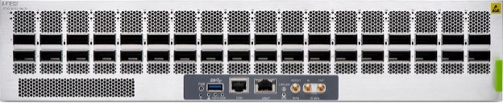

Figure 1: PTX10002-36CD

The Express 5 "BXM" ASIC forwards up to 4.96 billion packets per second, double the performance of Express 4, and consumes as little as 0.05 W per Gbps. The platform supports ZR/ZR+ coherent optics on the top row 18 ports and offers a migration path from 400GbE to 800GbE without hardware or software updates.

## Router Description

The PTX10002-36CD is a 2RU, standalone platform with no fabric connectivity requirements. The front panel carries 36x 400GbE ports or 18x 800GbE for a total of 14.4 Tbps. The management and timing ports sit on the front panel as on the other PTX10002 platforms. 

Table: PTX10002-36CD Specifications

| Specifications | Details |
|----------|----------|
| System Throughput | 14.4Tbps |
| Forwarding Capacity | Up to 5BPPS |
| Dimensions | H (2RU) x W (445mm) x D (564mm)  3.5"x17.28“x29.13" (H x W x D) |
| Rack Units | 2 RU, 800 mm rack including cables |
| Rack Mounting | 2/4-post |
| Max Weight | 55lbs (24.94 kg) |
| Power Supply | 2 PSMs, 2200 PSU, AC, DC, HVAC, HVDC,(1+1 Redundancy)|
| Cooling | 3x 2RU Fan Tray, AFO, Hot swappable |
| Power Consumption | 686W for 100% Traffic Load for 25C, 0ft, w/o optics, w/o MACSEC. |
| Operating Temperature | 0-40C (6000 ft) |

## ZR/ZR+ Optics Support

The top 18 ports support 400G ZR and 800G ZR optics. 
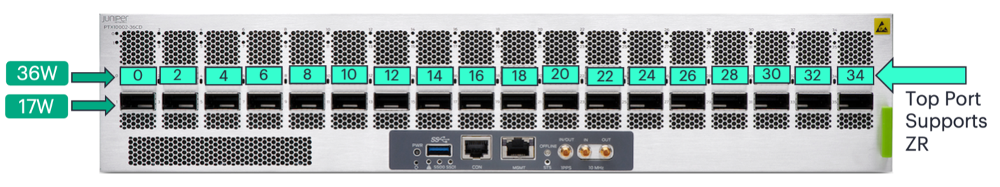
Figure 2: PTX10002-36CD ZR/ZR+ Optics Support

The qualified optics are JCO800-QDD-ZR-M-HP, QDD-400G-ZR, QDD-400G-ZR-M, QDD-400G-ZR-M-HP, JCO400-QDD-ZR, JCO400-QDD-ZR-M and JCO400-QDD-ZR-M-HP

#### Breakout Options:
Breakout optics support table 
> QSFP-DD800        All 18 ports support breakout 
>                               2 x 400G, 2 x 200G, 8 x 100G, 4 x 100G, 2 x 100G, 4 x 50G, 2 x 50G, 4 x 25G, 4 x 10G 

> QSFP-DD             All 36 ports support breakout 
>                              2 x 200G, 4 x 100G, 2 x 100G, 4 x 50G, 2 x 50G, 4 x 25G, 4 x 10G
Please validate port speeds and breakout options for your optics with the [Pathfinder Port Checker](https://apps.juniper.net/port-checker/ptx10002-36cd/)

## PLATFORM ARCHITECTURE
The usual "show chassis hardware details" provides a good overview of the internal parts.
root@ris-snp-svl-beta-w400-01> show chassis hardware 
Hardware inventory:

    Item             Version  Part number  Serial number     Description
    Chassis                                JY005             PTX10002-36CD [PTX10002-36CD]
    FPM 0            REV 04   711-183788   BCHV7810          FPM-PTX10002
    PSM 0            REV 02   740-148504   1GH5F460960       AC AFO 2200W PSM
    PSM 1            REV 02   740-148504   1GH5F460977       AC AFO 2200W PSM
    Routing Engine 0          BUILTIN      BUILTIN           RE-PTX10002-36CD
    CB 0             REV 12   750-182877   BCHV9459          Control Board
    FPC 0            REV 21   750-182881   BCHW8020          FPC-PTX10002-36CD
      PIC 0                   BUILTIN      BUILTIN           36x400GE PIC
        Xcvr 0       REV 01   740-150872   1W1CSKA929001     QSFP-DD800-800G-AOC-5M
        Xcvr 2       REV 01   740-150873   1W1CSLAA1400L     QSFP-DD800-800G-AOC-7M
        Xcvr 4       REV 01   740-150873   1W1CSLAA16005     QSFP-DD800-800G-AOC-7M
        Xcvr 6       REV 01   740-150872   1F1CSKA913001     QSFP-DD800-800G-AOC-5M
        Xcvr 8       REV 01   740-150876   1W1CSOAA04001     QSFP-DD800-800G-AOC-20M
        Xcvr 10      REV 01   740-150872   1W1CSKA929006     QSFP-DD800-800G-AOC-5M
        Xcvr 12      REV 01   740-150874   1W1CSMA749005     QSFP-DD800-800G-AOC-10M
        Xcvr 14      REV 01   740-150872   1F1CSKA913006     QSFP-DD800-800G-AOC-5M
        Xcvr 15      REV 01   740-088322   1W2CQ8A626013     QSFP28-100G-DR
        Xcvr 16      REV 01   740-150873   1W1CSLA933001     QSFP-DD800-800G-AOC-7M
        Xcvr 17      REV 01   740-088322   1W2CQ8A62600Q     QSFP28-100G-DR
        Xcvr 18      REV 01   740-150871   1W1CSJA929005     QSFP-DD800-800G-AOC-3M
        Xcvr 20      REV 01   740-150875   1F1CSNA801005     QSFP-DD800-800G-AOC-15M
        Xcvr 22      REV 01   740-150876   1W1CSOA937008     QSFP-DD800-800G-AOC-20M
        Xcvr 24      REV 01   740-150872   1F1CSKA913003     QSFP-DD800-800G-AOC-5M
        Xcvr 26      REV 01   740-145101   1F1CUCA90400C     QSFP-DD800-8x100G-FR1
        Xcvr 28      REV 01   740-150874   1F1CSMA749002     QSFP-DD800-800G-AOC-10M
        Xcvr 30      REV 01   740-150873   1W1CSLAA1600G     QSFP-DD800-800G-AOC-7M
        Xcvr 32      REV 01   740-150873   1W1CSLAA1600A     QSFP-DD800-800G-AOC-7M
        Xcvr 34      REV 01   740-150873   1F1CSLA913003     QSFP-DD800-800G-AOC-7M
    FTC 0            REV 05   711-183786   BCHV7357          Fan Control Board
    Fan Tray 0       REV 03   760-187795   BCHY4247          PTX10002 Fan Tray, Front to Back Airflow - AFO
    Fan Tray 1       REV 03   760-187795   BCHS1750          PTX10002 Fan Tray, Front to Back Airflow - AFO
    Fan Tray 2       REV 03   760-187795   BCHS1752          PTX10002 Fan Tray, Front to Back Airflow – AFO

#### Block Diagram
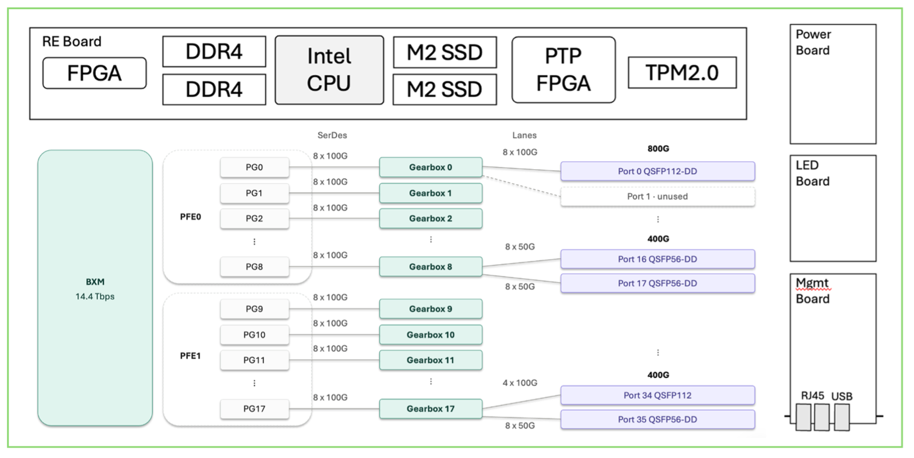

Figure 3: PTX10002-36CD block diagram.

The diagram in Figure 2 illustrates the different components in a PTX10002-36CD.

- Port groups: The Express 5 has 144 SerDes in 18 port groups (PG0 to PG17) of 8 SerDes each. They split into two datapaths: PFE0 (PG0–PG8) and PFE1 (PG9–PG17).
- Gearboxes: Each port group feeds its own gearbox (18 in total). Each gearbox serves two port cages, which gives the 36 ports.
- Port modes: A gearbox either drives two 400G QSFP56-DD ports at 8x50G, or one 800G QSFP112-DD port at 8x100G with the second port unused.

## Routing Engine Overview
The internal PTX10002-36CD Routing Engine is powered by an Intel Ice Lake-D 8-core processor running at frequency up to 3.1GHz. Note it’s a build-in RE, not a FRU (Field Replaceable Unit).

The Routing Engine is equipped with two 32 GB DDR4 RDIMMs (two DIMMs per channel), delivering a total memory capacity of 64GB operating at a memory speed of 2400 MT/s. For local storage, the platform supports two 200 GB NVMe SSDs, which are mounted on the bottom side of the Routing Engine board. A mechanical design provision allows the SSDs to be removed and serviced from the bottom of the chassis, simplifying maintenance operations.
Additionally, the platform supports Secure Boot mode, ensuring system integrity by allowing only trusted software to run during the boot process.

The PTX10002-36CD includes a Trusted Platform Module (TPM) 2.0 chip, which provides secure, non-volatile storage used as a persistent and access-controlled area for storing critical security information. This includes platform identity, cryptographic keys, security policies, and component registration data. The TPM enhances platform security by ensuring trusted system initialization and protecting sensitive information from unauthorized access.

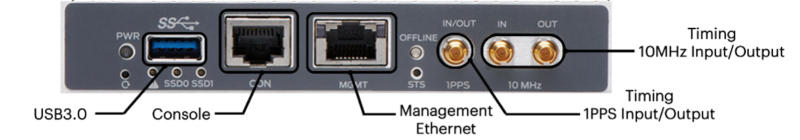

Figure 4: Management Ports of PTX10002-36CD.

The Juniper PTX10002-36CD provides several management and timing interfaces on the front panel to support system administration and network synchronization:

- 1x USB 3.0 port
- 1x RJ-45 management (MGT) port
- and 1x console (CON) port for local and remote management access.

For precise timing and synchronization, the platform supports: 

- 10 MHz input/output
- 1PPS (Pulse Per Second) input/output
- PTP Class D
- Sync-E

The front panel also includes status LEDs for Power, SSD0, SSD1, and Offline states, enabling quick visual monitoring of system health and operational status.

#### Fans and Power Supply Units
The rear of the PTX10002-36CD is identical to the PTX10002-60MR: three hot-swappable fan trays and two hot-swappable power supply modules.
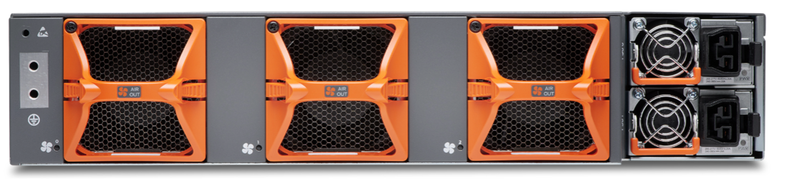
Figure 5: Backside view of PTX10002-36CD

The chassis has three fan trays using high-pressure 80 mm x 80 mm x 86 mm fans, with AFO (airflow out) cooling. Each tray draws 90W to 146W depending on thermal conditions and is rated for -10C to 70C. Fans run at about 16,000 RPM (+/-10%) at the inlet and 14,000 RPM (+/-10%) at the outlet. Each tray holds dual counter-rotating fans, and the chassis tolerates a single rotor failure.

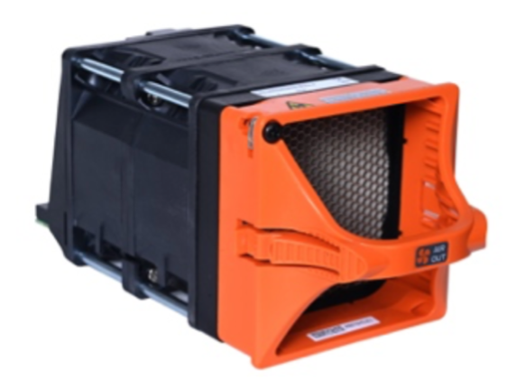

Figure 6: PTX10002-36CD Fan Tray

The chassis has two PSU slots. Available 2,200W modules are AC (240V), DC and HVDC/HVAC options with a single feed. The chassis supports 1+1 PSU or feed redundancy.
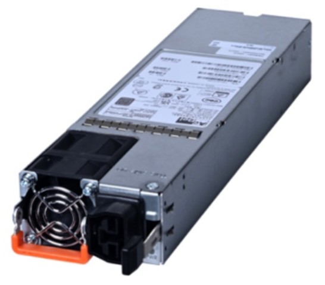

Figure 7: PTX10002-36CD AC Power Unit

#### Interfaces
The PTX10002-36CD (like all members of the PTX10k Series) is an Ethernet-only router. 
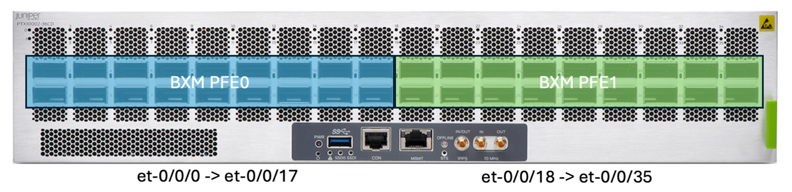
Figure 8: Port to PFE mapping

Half of the ports will be mapped (directly or indirectly) to one Datapath/PFE. The Figure 8 above is displaying this mapping.

#### Port Naming Logic
The system is made of a single Flexible PIC Card (FPC) and a single Physical Interface Card (PIC), it simplifies the port naming significantly: all interfaces are named et-0/0/[0-35]:[0-7]

#### Different Port Options
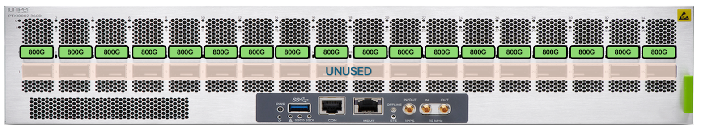
Figure 9: All 800G options

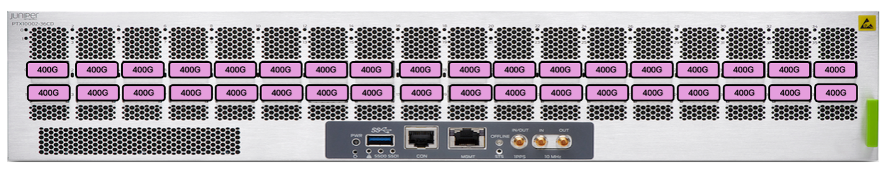
Figure 10: All 400G options

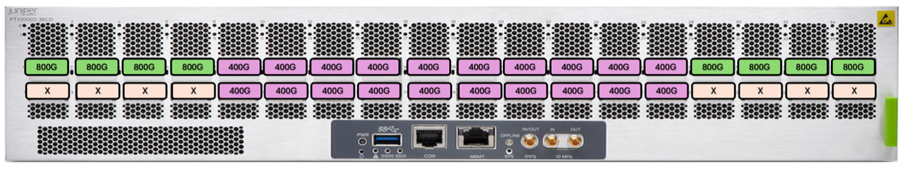

Figure 11: Mix of 800G and 400G options.

As a quick on-box reference, the following CLI command shows transceivers plugged into the port, plus the port speed capabilities (note: it shows capabilities and not necessarily the software support. Please use the port checker and hardware compatibility tools on apps.juniper.net to verify the support).

    root@ris-snp-svl-beta-w400-01> show chassis pic fpc-slot 0 pic-slot 0  
    FPC slot 0, PIC slot 0 information:
      Type                             36x400GE PIC
      State                            Online    
      PIC version                   255.09
      Uptime			   9 days, 7 hours, 15 minutes, 36 seconds
    
    PIC port information:
                             Fiber                    Xcvr vendor       Wave-                     Xcvr          JNPR     MSA               Short/Long
      Port Cable type        type  Xcvr vendor        part number       length                    Firmware      Rev      Version           Port
      0    800G-AOC 5M       MM    JUNIPER-1W1        740-150872        1311 nm                   3.6.00        REV 01   CMIS 5.1      L      
      2    800G-AOC 7M       MM    JUNIPER-1W1        740-150873        1311 nm                   3.6.00        REV 01   CMIS 5.1      L      
      4    800G-AOC 7M       MM    JUNIPER-1W1        740-150873        1311 nm                   3.6.00        REV 01   CMIS 5.1      L      
      6    800G-AOC 5M       MM    JUNIPER-1F1        740-150872        1310 nm                   107.11.00     REV 01   CMIS 5.1      L      
      8    800G-AOC 20M      MM    JUNIPER-1W1        740-150876        1311 nm                   3.6.00        REV 01   CMIS 5.1      L      
      10   800G-AOC 5M       MM    JUNIPER-1W1        740-150872        1311 nm                   3.6.00        REV 01   CMIS 5.1      L      
      12   800G-AOC 10M      MM    JUNIPER-1W1        740-150874        1311 nm                   3.5.00        REV 01   CMIS 5.1      L      
      14   800G-AOC 5M       MM    JUNIPER-1F1        740-150872        1310 nm                   107.11.00     REV 01   CMIS 5.1      L      
      15   100G DR           SM    JUNIPER-1W2        1W2Q8A            1311 nm                   0.0           REV 01   SFF-8636 ver 2.10 NA     
      16   800G-AOC 7M       MM    JUNIPER-1W1        740-150873        1311 nm                   3.6.00        REV 01   CMIS 5.1      L      
      17   100G DR           SM    JUNIPER-1W2        1W2Q8A            1311 nm                   0.0           REV 01   SFF-8636 ver 2.10 NA     
      18   800G-AOC 3M       MM    JUNIPER-1W1        740-150871        1311 nm                   3.6.00        REV 01   CMIS 5.1      L      
      20   800G-AOC 15M      MM    JUNIPER-1F1        740-150875        1310 nm                   107.11.00     REV 01   CMIS 5.1      L      
      22   800G-AOC 20M      MM    JUNIPER-1W1        740-150876        1311 nm                   3.6.00        REV 01   CMIS 5.1      L      
      24   800G-AOC 5M       MM    JUNIPER-1F1        740-150872        1310 nm                   107.11.00     REV 01   CMIS 5.1      L      
      26   8x100G-FR1        SM    JUNIPER-1F1        740-145101        1311 nm                   94.11.00      REV 01   CMIS 5.1      L      
      28   800G-AOC 10M      MM    JUNIPER-1F1        740-150874        1310 nm                   107.11.00     REV 01   CMIS 5.1      L      
      30   800G-AOC 7M       MM    JUNIPER-1W1        740-150873        1311 nm                   3.6.00        REV 01   CMIS 5.1      L      
      32   800G-AOC 7M       MM    JUNIPER-1W1        740-150873        1311 nm                   3.6.00        REV 01   CMIS 5.1      L      
      34   800G-AOC 7M       MM    JUNIPER-1F1        740-150873        1310 nm                   107.11.00     REV 01   CMIS 5.1      L      

Port speed information:

    Port  PFE  Port-Group      Capable Port Speeds
      0      0       0          1x10G 1x40G 4x10G 1x25G 4x25G 1x100G 1x200G 4x50G 2x100G 1x400G 2x200G 4x100G 8x50G 1x800G 2x400G 4x200G 8x100G 7x100G     6x100G 5x100G 3x100G 3x200G 
      1      0       0          1x10G 1x40G 4x10G 1x25G 4x25G 1x100G 1x200G 4x50G 2x100G 1x400G 2x200G 4x100G 
      2      0       1          1x10G 1x40G 4x10G 1x25G 4x25G 1x100G 1x200G 4x50G 2x100G 1x400G 2x200G 4x100G 8x50G 1x800G 2x400G 4x200G 8x100G 7x100G     6x100G 5x100G 3x100G 3x200G 
      3      0       1          1x10G 1x40G 4x10G 1x25G 4x25G 1x100G 1x200G 4x50G 2x100G 1x400G 2x200G 4x100G 
      4      0       2          1x10G 1x40G 4x10G 1x25G 4x25G 1x100G 1x200G 4x50G 2x100G 1x400G 2x200G 4x100G 8x50G 1x800G 2x400G 4x200G 8x100G 7x100G     6x100G 5x100G 3x100G 3x200G 
      5      0       2          1x10G 1x40G 4x10G 1x25G 4x25G 1x100G 1x200G 4x50G 2x100G 1x400G 2x200G 4x100G 
      6      0       3          1x10G 1x40G 4x10G 1x25G 4x25G 1x100G 1x200G 4x50G 2x100G 1x400G 2x200G 4x100G 8x50G 1x800G 2x400G 4x200G 8x100G 7x100G     6x100G 5x100G 3x100G 3x200G 
      7      0       3          1x10G 1x40G 4x10G 1x25G 4x25G 1x100G 1x200G 4x50G 2x100G 1x400G 2x200G 4x100G 
      8      0       4          1x10G 1x40G 4x10G 1x25G 4x25G 1x100G 1x200G 4x50G 2x100G 1x400G 2x200G 4x100G 8x50G 1x800G 2x400G 4x200G 8x100G 7x100G     6x100G 5x100G 3x100G 3x200G 
      9      0       4          1x10G 1x40G 4x10G 1x25G 4x25G 1x100G 1x200G 4x50G 2x100G 1x400G 2x200G 4x100G 
      10     0       5          1x10G 1x40G 4x10G 1x25G 4x25G 1x100G 1x200G 4x50G 2x100G 1x400G 2x200G 4x100G 8x50G 1x800G 2x400G 4x200G 8x100G 7x100G     6x100G 5x100G 3x100G 3x200G 
      11     0       5          1x10G 1x40G 4x10G 1x25G 4x25G 1x100G 1x200G 4x50G 2x100G 1x400G 2x200G 4x100G 
      12     0       6          1x10G 1x40G 4x10G 1x25G 4x25G 1x100G 1x200G 4x50G 2x100G 1x400G 2x200G 4x100G 8x50G 1x800G 2x400G 4x200G 8x100G 7x100G     6x100G 5x100G 3x100G 3x200G 
      13     0       6          1x10G 1x40G 4x10G 1x25G 4x25G 1x100G 1x200G 4x50G 2x100G 1x400G 2x200G 4x100G 
      14     0       7          1x10G 1x40G 4x10G 1x25G 4x25G 1x100G 1x200G 4x50G 2x100G 1x400G 2x200G 4x100G 8x50G 1x800G 2x400G 4x200G 8x100G 7x100G     6x100G 5x100G 3x100G 3x200G 
      15     0       7          1x10G 1x40G 4x10G 1x25G 4x25G 1x100G 1x200G 4x50G 2x100G 1x400G 2x200G 4x100G 
      16     0       8          1x10G 1x40G 4x10G 1x25G 4x25G 1x100G 1x200G 4x50G 2x100G 1x400G 2x200G 4x100G 8x50G 1x800G 2x400G 4x200G 8x100G 7x100G     6x100G 5x100G 3x100G 3x200G 
      17     0       8          1x10G 1x40G 4x10G 1x25G 4x25G 1x100G 1x200G 4x50G 2x100G 1x400G 2x200G 4x100G 
      18     1       17         1x10G 1x40G 4x10G 1x25G 4x25G 1x100G 1x200G 4x50G 2x100G 1x400G 2x200G 4x100G 8x50G 1x800G 2x400G 4x200G 8x100G 7x100G     6x100G 5x100G 3x100G 3x200G 
      19     1       17         1x10G 1x40G 4x10G 1x25G 4x25G 1x100G 1x200G 4x50G 2x100G 1x400G 2x200G 4x100G 
      20     1       16         1x10G 1x40G 4x10G 1x25G 4x25G 1x100G 1x200G 4x50G 2x100G 1x400G 2x200G 4x100G 8x50G 1x800G 2x400G 4x200G 8x100G 7x100G     6x100G 5x100G 3x100G 3x200G 
      21     1       16         1x10G 1x40G 4x10G 1x25G 4x25G 1x100G 1x200G 4x50G 2x100G 1x400G 2x200G 4x100G 
      22     1       15         1x10G 1x40G 4x10G 1x25G 4x25G 1x100G 1x200G 4x50G 2x100G 1x400G 2x200G 4x100G 8x50G 1x800G 2x400G 4x200G 8x100G 7x100G     6x100G 5x100G 3x100G 3x200G 
      23     1       15         1x10G 1x40G 4x10G 1x25G 4x25G 1x100G 1x200G 4x50G 2x100G 1x400G 2x200G 4x100G 
      24     1       14         1x10G 1x40G 4x10G 1x25G 4x25G 1x100G 1x200G 4x50G 2x100G 1x400G 2x200G 4x100G 8x50G 1x800G 2x400G 4x200G 8x100G 7x100G     6x100G 5x100G 3x100G 3x200G 
      25     1       14         1x10G 1x40G 4x10G 1x25G 4x25G 1x100G 1x200G 4x50G 2x100G 1x400G 2x200G 4x100G 
      26     1       13         1x10G 1x40G 4x10G 1x25G 4x25G 1x100G 1x200G 4x50G 2x100G 1x400G 2x200G 4x100G 8x50G 1x800G 2x400G 4x200G 8x100G 7x100G     6x100G 5x100G 3x100G 3x200G 
      27     1       13         1x10G 1x40G 4x10G 1x25G 4x25G 1x100G 1x200G 4x50G 2x100G 1x400G 2x200G 4x100G 
      28     1       12         1x10G 1x40G 4x10G 1x25G 4x25G 1x100G 1x200G 4x50G 2x100G 1x400G 2x200G 4x100G 8x50G 1x800G 2x400G 4x200G 8x100G 7x100G     6x100G 5x100G 3x100G 3x200G 
      29     1       12         1x10G 1x40G 4x10G 1x25G 4x25G 1x100G 1x200G 4x50G 2x100G 1x400G 2x200G 4x100G 
      30     1       11         1x10G 1x40G 4x10G 1x25G 4x25G 1x100G 1x200G 4x50G 2x100G 1x400G 2x200G 4x100G 8x50G 1x800G 2x400G 4x200G 8x100G 7x100G     6x100G 5x100G 3x100G 3x200G 
      31     NA      11         1x10G 1x40G 4x10G 1x25G 4x25G 1x100G 1x200G 4x50G 2x100G 1x400G 2x200G 4x100G 
      32     1       10         1x10G 1x40G 4x10G 1x25G 4x25G 1x100G 1x200G 4x50G 2x100G 1x400G 2x200G 4x100G 8x50G 1x800G 2x400G 4x200G 8x100G 7x100G     6x100G 5x100G 3x100G 3x200G 
      33     1       10         1x10G 1x40G 4x10G 1x25G 4x25G 1x100G 1x200G 4x50G 2x100G 1x400G 2x200G 4x100G 
      34     1       9          1x10G 1x40G 4x10G 1x25G 4x25G 1x100G 1x200G 4x50G 2x100G 1x400G 2x200G 4x100G 8x50G 1x800G 2x400G 4x200G 8x100G 7x100G     6x100G 5x100G 3x100G 3x200G 
      35     1       9          1x10G 1x40G 4x10G 1x25G 4x25G 1x100G 1x200G 4x50G 2x100G 1x400G 2x200G 4x100G 
    

Please check the above CLI output “Port Speed Information” carefully to understand the breakout capabilities. It’s important to understand we talk about port capability here, not port support. We expose what the physical port can do in terms of SerDes, clocks, etc. But it doesn’t mean the software to support it has been implemented, or that it is fully tested. Again, we advise to use the port checker tool from pathfinder for authoritative information.

We need a QSA adapter to operate 25GE or 10GE as standalone interfaces. 

#### Max Port Count
Table: Port Count

| Port Speed | Port Position | Max Number of Ports | Max TotalPer System|
|----------|----------|----------|----------|
| 800GE | [0,2,4,6,8,10,12,14,16,18,20,22,24,26,28,30,32,34] | 18 | 18 |
| 400GE | [0-35] | 36 (Native) | 36 |
| 200GE | [0-35] | 36 (2x200G BO) | 72 |
| 100GE | [0-17] | 18 (8x100G BO) | 144 |
| 100GE | [0-35] | 36 (4x100G BO) | 144 |
| 50GE | [0-17] | 18 (8x50G BO) | 144 |
| 25GE | [0-17] | 18 (8x25G BO) | 144 |
| 25GE | [0-35] | 36 (4x35G BO) | 144 |
| 10GE | [0-35] | 36x (4x10G BO) | 144 |

### Target Use Cases
The PTX10002-36CD targets three primary roles: Core, Peering and DCI. It also fits data center edge, metro aggregation and AI data center networks.

#### Core
Core routing forms the high-speed backbone that carries massive traffic volumes between data centers, regional networks and service provider PoPs. With 36x 400GbE ports in 2RU, the PTX10002-36CD gives operators dense 400G capacity at a low cost per bit and low watts per Gbps. Its deep buffers and large FIB scale, together with MPLS, SR-MPLS, SRv6 and RSVP-TE, enable scalable traffic engineering across large backbones. Built-in MACsec secures links, and ZR/ZR+ optics extend reach without external transport gear. Customers can move from 400GbE to 800GbE without hardware or software updates.
#### Peering
Peering lets independent networks interconnect directly, bypassing transit providers to cut latency and transit cost. The PTX10002-36CD suits peering with high RIB and FIB scale (RIB 40M-60M, FIB 4M+ on the Express 5 platform family), enough for full Internet tables, and support for thousands of BGP peers toward transit providers, CDNs and Internet exchanges. A non-blocking architecture, efficient load balancing and fine-grained policy and filter scale add the flexibility large peering environments need. [Confirm 36CD-specific scale numbers from datasheet]
#### DCI
Data Center Interconnect carries traffic between geographically distributed data centers for workload mobility, data replication, disaster recovery and large AI workloads. The PTX10002-36CD offers secure 400G interfaces and 14.4 Tbps of capacity to move east-west traffic efficiently. ZR/ZR+ optics enable long-haul connectivity between sites and reduce dependence on external optical transport systems. Deep buffers, wide ECMP, and RoCEv2, PFC and ECN support help latency-sensitive and AI-driven workloads, while line-rate MACsec protects inter-data-center links. EVPN and VXLAN round out the DCI toolset.

#### Silicon, Software and Security
The PTX10002-36CD is powered by a single Express 5 Packet Forwarding Engine. Express 5 is an ASIC family and the first in the industry with a chiplet-based design. For background, see the Express 5 overview and the PTX10002-36QDD introduction.
Platform capabilities, shared with the PTX10002 family unless the datasheet says otherwise:
- Line-rate MACsec, implemented in the BXM ASIC and clock-gated until configured
- ZR/ZR+ coherent optics support
- Precision timing with Sync-E and PTP
- Secure Boot, TPM 2.0 and Secure Zero-Touch Provisioning
- Core and peering routing: IP, MPLS, SR-MPLS, SRv6, RSVP-TE, SR-TE, BGP-LS and PCEP
- L2/L3 services: VPLS, EVPN-VPWS, EVPN-MPLS and EVPN-VXLAN
- Multicast: MVPN, NG-MVPN and MPLS BIER
- Hierarchical QoS, RoCEv2, PFC and ECN
- Telemetry: In-band Network Telemetry, sFlow, JFlow and IMON

The platform runs Junos OS Evolved and offers flexible licensing so costs can follow network growth. [Confirm software release and feature list from datasheet]

#### Key Benefits
- 14.4 Tbps in 2RU
- Dense 400GbE with ZR/ZR+ and a seamless path to 800GbE
- Express 5 silicon for high performance and low power per bit
- One platform for Core, Peering, DCI, data center edge and metro aggregation

## Conclusion
The PTX10002-36CD brings 14.4 Tbps of 400GbE capacity to a compact, power-efficient 2RU platform. With Express 5 silicon, ZR/ZR+ support, MACsec and the Junos software stack, it helps operators build high-capacity Core, Peering and DCI networks while optimizing power and cost per bit, and it keeps the door open to 800GbE.

#### Useful Links
[PTX10002-36CD datasheet](https://www.hpe.com/us/en/resources.data-sheet.hpe-juniper-networking-ptx10002-36cd-router.a00155674enw.html)

[PTX10002-36CD product page](https://buy.hpe.com/us/en/p/1014929795)

[Pathfinder Port Checker](https://apps.juniper.net/port-checker/ptx10002-36cd/)
[Introduction to Express 5](https://community.arubanetworks.com/blogs/dmitry-shokarev1/2024/03/12/express-5-overview)

[Reference blog: Introducing the PTX10002-60MR](https://community.networking.hpe.com/blogs/santo-k/2026/03/19/introducing-the-ptx10002-60mr)

