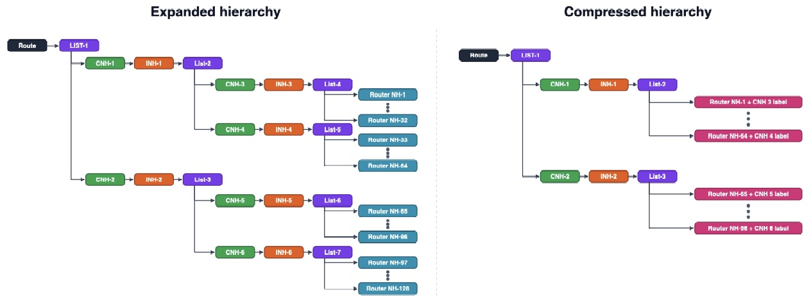
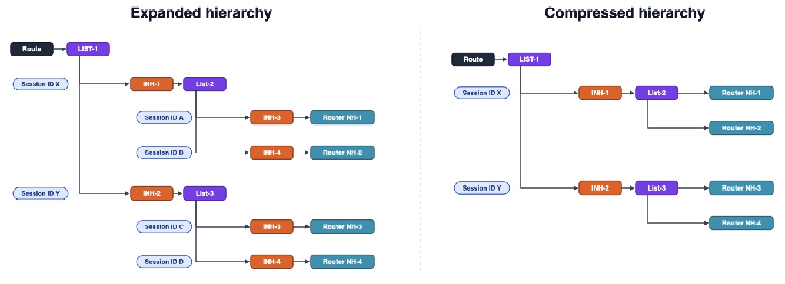
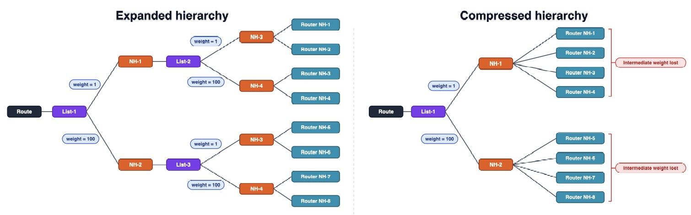
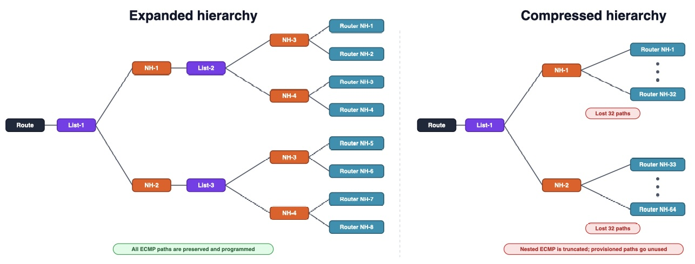

# Preserving the Nexthop Hierarchy

**Navaneetha Krishnan Vasudevan, Kaliraj Vairavakalai, Ravi MR - 2026-10-21**

## Introduction

Cloud and service-provider networks have grown enormously in scale and complexity, and the traffic they carry has increased exponentially year over year. This brief examines how nexthop hierarchies are traditionally programmed in router forwarding hardware, why that traditional approach — compressed hierarchy — runs into trouble at high scale in cloud and SP networks, and how preserving the nexthop hierarchy (expanded hierarchy) solves it. We close with measured scale and convergence results from production EVPN deployments, guidance on how to enable the feature, and the current qualification status for customer deployments.
Cloud and service-provider networks have grown enormously in scale and complexity, and the traffic they carry has increased exponentially year over year. To keep up, networks are built to run services over transports — customer-facing services like BGP Internet, L3VPN, EVPN, riding on top of transport protocols like ISIS, OSPF, LDP, RSVP-TE, BGP-LU and increasingly SR-TE, BGP-CT and SRv6. Operators layer these freely: a service such as BGP Internet may run over BGP-LU over IPIP tunnels, BGP L3VPN may run over SR over MPLS-over-UDP, and BGP L3VPN may run over BGP-LU over LDP/RSVP-TE.
Networks are also being built in a disaggregated and scale-out manner, which increases the number of routing endpoints, redundancy and load-balancing paths in the network.
Underneath all of this sits a deceptively simple question: how does the router represent these layered paths in forwarding hardware? The answer — how we build the nexthop hierarchy — turns out to have an outsized effect on scale, convergence, and resiliency. In this article we will look at how nexthop hierarchies are traditionally programmed, why that traditional approach runs into trouble at high scale in cloud and SP networks, and how preserving the nexthop hierarchy (also called expanded hierarchy) solves it. We close with measured results from EVPN deployments.

## How Routes and Nexthops Are Programmed

When a router learns that a destination is reachable, it stores that reachability as a route pointing at a nexthop. In a layered network, that nexthop is itself a small hierarchy:
- The service protocol (say, BGP L3VPN or BGP-EVPN) knows the destination PE and the service label to reach it, but not the physical path.
- The transport protocol (LDP, RSVP-TE, SR-TE, BGP-LU) knows how to actually reach that PE — which interface to send on, and which transport label to push.
- The RPD resolver stitches these together, recursively resolving the service's indirect nexthop (the remote PE's loopback) down through the transport routes to a real forwarding nexthop (FNH) — an actual outgoing interface and next router.

So a single service route conceptually resolves through a chain: service layer encap -> transport layer encap -> physical forwarding nexthop. The 'encap' can be either MPLS-label(s) or IP/UDP/SR encap, as needed by the deployment. In this document, we give examples using MPLS-label as encap.

The interesting design decision is what the router does with that chain when it programs the packet forwarding engine (PFE).

### Compressed Hierarchy: The Traditional Approach
Historically, the router flattens the chain. It keeps the service hierarchy but collapses all the transport levels — merging every service and transport label into the final forwarding nexthop. This is called compressed hierarchy: service labels are merged into the transport FNH.

Compressed hierarchy is simplistic, and for small networks it is perfectly adequate. The problem is what happens to the forwarding-nexthop count when services stack over transport-tunnels, optionally with ECMP fanout at each level.

## Why Compressed Hierarchy Breaks at Scale

Because a compressed FNH bakes the full label stack into a single forwarding entry, every distinct combination of labels along the path needs its own forwarding nexthop. When the underlying transports offer ECMP or/and PIC — as production networks always do, for loadbalancing and redundancy — there is a combinatorial explosion of FNHs.

Consider a representative case: 10,000 BGP-LU routes, each resolving over an LDP route with 8-way ECMP, where each of those legs in turn goes over RSVP-TE with another 8-way ECMP. Under compressed hierarchy, each BGP-LU route needs 8 x 8 = 64 forwarding nexthops, because the LU label must be merged with every LDP-label/RSVP-TE path combination:

Table: Forwarding-nexthop count under compressed hierarchy — 10,000 BGP-LU routes over 8-way ECMP LDP over 8-way ECMP RSVP-TE.

| Nexthop type | Count in PFE (compressed) |
|----------|----------|
| Indirect (INH) | 10 K |
| Chain composite (CNH) | 0 |
| Unicast forwarding nexthops (FNH) | 64 x 10 K = 640 K |
| Unilists | 10 K |
| Total | ~66000 |

The forwarding-nexthop table explodes — 640 K FNHs for what is, logically, a very regular structure. This is the scaling problem with compressed hierarchy, and it directly consumes scarce PFE nexthop memory. Operators running services over existing transports (L3VPN over BGP-LU over LDP over RSVP-TE) hit PFE memory exhaustion and asked, reasonably, why?

Compressed hierarchy further causes three functional problems beyond raw scaling issues:

- ECMP truncation. When a flattened structure becomes a unilist pointing to a unilist, ECMP legs get truncated by the chassis' max ecmp limit — so the router cannot actually use all the redundant links the operator has provisioned. Networks with redundant links at every level were left unable to use paths that were physically present.
- Loss of hierarchical weights and bandwidth. Weighted load-balancing information carried in the hierarchy is lost when the levels are merged. BGP PIC for services resolved over BGP-LU is not possible, because intermediate Indirect NHs representing those border-nodes are not preserved in PFE, as the levels are merged.
- Statistics-counter explosion. Per-path statistics requirements multiply the nexthop count further.

## What "Preserve-Nexthop-Hierarchy" Is, and How It Differs

preserve-nexthop-hierarchy — equivalently, expanded hierarchy — does exactly what the name says: instead of merging service labels down into the forwarding nexthop, it keeps each service label in its own chain composite nexthop (CNH) and preserves the INHs in the service and transport hierarchies as the protocols originally produced them. This promotes sharing of resources, and resiliency through decoupling.

The distinction in one line:

- Compressed hierarchy: merge service labels into the transport forwarding nexthop.
- Expanded hierarchy: keep each service label in a separate chain composite, leaving the transport hierarchy intact underneath it.

In the expanded hierarchy, each level — chain composite (CNH), indirect nexthop (INH), and unilist — is preserved as the protocols produced it, and the router nexthops at the bottom are shared. In the compressed hierarchy, those levels are flattened and the labels are pushed down into each router nexthop, so the forwarding entries multiply.

The difference in the resulting hardware footprint is dramatic. Take the same 10,000 BGP-LU-over-LDP-over-RSVP example and program it with expanded hierarchy:

Table: Forwarding-nexthop count, compressed vs. expanded hierarchy — same 10,000-route example as Table 1

| Nexthop type | Compressed | Expanded |
|----------|----------|----------|
| Indirect (INH) | 10 K | 10 K |
| Chain composite (CNH) | 0 | 10 K (LU) + 8 (LDP) |
| Unicast forwarding nexthops (FNH) | 640 K | 8 x 8 = 64 |
| Unilists | 10 K  | 1 (LDP) + 8 (RSVP) = 9 |
| Total | ~660,000 | ~20,081 |

The forwarding-nexthop count collapses from 640 K to 64, because the transport nexthops are shared across all the service routes above them rather than being duplicated into every combination. The total nexthop count drops by roughly 30x.

The same effect shows up even more starkly in an LDP-over-RSVP topology with 20 K routes: compressed hierarchy produces roughly 1.3 million forwarding nexthops, while expanded hierarchy produces about 64 — a reduction of approximately 1.3 million nexthops, using the identical shared-transport-nexthop structure shown in Figure 1.

## How Preserving the Hierarchy Solves Real World Problems

Keeping the hierarchy intact addresses each of the compressed-mode problems directly.

### Scale

As shown above, transport forwarding nexthops are shared instead of duplicated, so the FNH table no longer explodes as services stack over multi-path transports. This is what pulls PFE nexthop memory back under control.

### Resiliency and Fast Reroute at Every Level

Because the intermediate levels are preserved rather than flattened, the PFE can perform local repair (BGP PIC / FRR) at every layer of the hierarchy independently — service, BGP-LU transport, and IGP transport. The redundant links the operator provisioned at each level are now actually usable, and a failure at any level can be repaired locally without waiting for the control plane to recompute the levels above it. Deployments that need FRR at every intermediate level have achieved convergence of under 1.5 seconds with the PFE doing local repair at each level — something that was not achievable with compressed hierarchy.

## Preservation of Hierarchical Weights and Bandwidth

In compressed hierarchy, when the levels are merged the weighted load-balancing information carried at each level is lost, so traffic no longer splits across paths in the proportions the operator intended. Expanded hierarchy keeps each level intact, so the hierarchical weights and bandwidth values are preserved end to end and weighted ECMP behaves as designed.

### No ECMP Truncation
Compressed hierarchy can collapse a structure into a unilist pointing to a unilist, at which point ECMP legs are truncated and some of the provisioned paths simply disappear from the forwarding plane. Because expanded hierarchy does not merge those intermediate unilists, there is no truncation — every ECMP path is programmed in the PFE and actively used, so the operator gets the full redundancy and load-sharing they built into the network.

### Where It Helps

Expanded hierarchy unblocks deployments that were previously impractical or impossible: multi-level services resolving over IPIP tunnels (which would otherwise cause tunnel-nexthop explosion); complex stacks such as BGP over SR over MPLS-over-UDP that were never supported under compression; RSVP auto-bandwidth applications, where periodic re-signaling causes FNH churn — reducing the FNH count lets such applications measure link bandwidth at far more aggressive intervals; and any network that requires fast reroute at every intermediate level. Preserve-nexthop-hierarchy also helps improve scale and convergence in AI-fabric DCI use cases, where different service and transport technologies may converge on the same routing platform - for example, EVPN over VXLAN or L3VPN over UDP-based tunnels on the AI-fabric side, and L3VPN over RSVP-TE/MPLS on the DCI/WAN side.

## A Note on Platform Limitations

Preserving the hierarchy is the right default, but real forwarding hardware imposes real limits on how deep or how wide a nexthop hierarchy can be. Different forwarding ASICs differ substantially — for example, the number of labels supported in a chain varies widely across platforms:

Table: Chain-composite label depth supported, by platform

| Platform | Labels supported in chain |
|----------|----------|
| MX Series (Trio) | 15 |
| Express 4 (e.g., PTX10001-36MR)| 2 |
| Express 5 (e.g., PTX10002-36QDD)| 4 |

Because the ideal expanded hierarchy that RPD produces will not fit every one of these platforms as-is, RPD uses a platform layer that walks each route's nexthop hierarchy and translates it into the most optimal form the target hardware can support — merging only the labels that must be merged, and (where the hardware supports it, as on Express 4) marking the last chain as an egress chain rather than collapsing labels all the way into the forwarding nexthop. This keeps a single, clean expanded hierarchy in the RPD RIB layer while still honoring each platform's constraints, and it is transparent to the operator: the platform parameters live in factory configuration rather than being something to understand or tune. The platform layer is a substantial topic in its own right, worthy of a dedicated treatment of its own.

## Measured Results: EVPN Nexthop Simplification

The clearest demonstration of the benefit comes from EVPN. In the new model, EVPN ELAN service moves from an indirect-nexthop model to a chain-composite model that decouples the service label from the transport nexthops and shares the transport nexthop across services, with preserve-nexthop-hierarchy enabled for all EVPN service nexthops.

The results below are for EVPN-MPLS MAC-VRF, measured on PTX Express 4 and Express 5 platforms, shown here as a representative case. Because preserve-nexthop-hierarchy is a common forwarding-plane mechanism rather than an EVPN-specific feature, the same scale and convergence benefits apply to the other qualified services such as L3VPN, BGP-LU, BGP-CT, SR-TE, and SRv6.

### Scale

The forwarding-nexthop math for EVPN multihoming is striking. Under the old model, the number of forwarding nexthops grows with the product of instances, ESIs, and remote PEs:
> Old model: #FNH = (#instances) x (#ESI) x (#remote PEs). For 4,000 instances, each with 2 ESI IFLs, and 100 remote PEs: 4,000 x 2 x 100 = 800,000 forwarding nexthops.

> New model (preserved hierarchy): #FNH = #remote PEs = 100.

That is a reduction from 800,000 to 100 (99.99%) — because the transport nexthops toward the remote PEs are shared rather than duplicated per instance and per ESI.

### Convergence

Preserving the hierarchy also transforms convergence, because failures can be repaired at the transport level once rather than per-service. Measured convergence times across three EVPN service types — VPWS, Type-5 (T5), and ELAN — old model versus new model:

Table: Measured convergence time, old (indirect-nexthop) model vs. new (preserved-hierarchy) model, by failure scenario and EVPN service type

| Failure scenario | VPWS (old -> new) | T5 (old -> new) | ELAN (old -> new) |
|----------|----------|----------|----------|
| Transit ASBR router reboot | 2.5 s -> 113 ms | 2.2 s -> 115 ms | 3.2 s -> 178 ms |
| FPC restart on transit ASBR | 2.2 s -> 589 ms | 2.0 s -> 175 ms | 2.9 s -> 200 ms |
| P-router reboot (PE-ASBR) | -> 137 ms | -> 137 ms | -> 147 ms |
| Directly connected link cut on PE | 1.0 s -> 103 ms | 1.0 s -> 103 ms | 1.0 s -> 102 ms |

Across the board, convergence drops from multiple seconds to the low hundreds of milliseconds — roughly an order of magnitude improvement — while the nexthop scale drops by nearly four orders of magnitude. Convergence is no longer coupled to the number of services affected, because the shared transport nexthop is repaired once and every service above it benefits immediately.

## List of qualified features and future roadmap information
Preserve-nexthop-hierarchy is being qualified and rolled out progressively across platforms and services.  Please refer to TechPost documents for list of qualified features. Reach out to PLMs for future roadmap information

## A Note on the Trade-off
Preserving the hierarchy is not free. Because the forwarding plane may traverse several nexthop levels — chain composite, indirect, and unilist — rather than a single flattened forwarding nexthop, it can introduce additional per-packet lookup cost compared with compressed hierarchy. This is a deliberate trade-off for the substantial gains in scale and convergence shown above. It is also exactly why the platform layer matters: on hardware sensitive to hierarchy depth, the platform layer limits how many levels the PFE must traverse, keeping the forwarding cost under control while retaining the benefits of an expanded model wherever the hardware allows.

## Conclusion

The way a router represents layered paths in forwarding hardware is not a minor implementation detail — at cloud scale it determines whether the network fits in PFE memory, whether it can use the redundancy the operator paid for, and how fast it recovers from failure. Compressed hierarchy, which served earlier networks well, duplicates transport forwarding state into every service-and-path combination and runs into a wall as services stack over multi-path transports.
Preserving the nexthop hierarchy keeps the structure the protocols intended, shares transport nexthops instead of duplicating them, and unlocks fast reroute at every level. The result, as the EVPN numbers show, is dramatically lower nexthop scale and dramatically faster convergence — turning deployments that were previously impractical into ones that simply work. And because it is a reusable forwarding-plane primitive rather than a service feature, it forms a foundation that newer resolver architectures continue to build on.

### References
preserve-nexthop-hierarchy, Junos OS Documentation: [https://www.juniper.net/documentation/us/en/software/junos/static-routing/topics/concept/preserve-nexthop-hierarchy.html](https://example.com)

### Glossary
- PNH: Preserve-Nexthop-Hierarchy (expanded hierarchy)
- FNH: Forwarding Nexthop
- INH: Indirect Nexthop
- CNH: Chain Composite Nexthop
- PFE: Packet Forwarding Engine
- ECMP: Equal-Cost Multi-Path
- PIC: Prefix Independent Convergence
- FRR: Fast Reroute
- BGP-LU: BGP Labeled Unicast
- BGP-CT: BGP Classful Transport

### About the Authors

- Navaneetha Krishnan Vasudevan — Distinguished Technologist, Routing Protocol Infrastructure team.
- Kaliraj Vairavakalai — Distinguished Technologist, Routing Protocol BGP team.
- Ravi MR — Senior Principal Engineer, Routing Protocol Infrastructure team.

